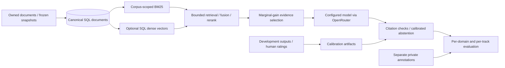

# RagMTL (MAGRA)

MAGRA is an experimental, CPU-capable retrieval and grounded-answer pipeline, with a reusable benchmark and development-only evaluation controls. It uses **SQLite as the canonical document store** and **`minimax/minimax-m3.1-flash`** through OpenRouter. The preferred local setting is `ai-model-key-increased-paid`, with an authorized ceiling of **$100 per UTC month** and one shared ledger preserving all previous spending. Confirmed API credit, budget or quota exhaustion stops the whole goal until the user restores access. No improvement over the strongest feasible baseline is claimed yet.

## Repository boundaries

RagMTL owns the MAGRA retrieval, evidence aggregation, benchmarking, and continuity packages. [BackToMTL](https://github.com/kusicheng/backtomtl) owns the translation backend and image processing. [OpenMTL](https://github.com/kusicheng/openmtl) owns the frontend and user-facing application.

These are separate repositories. Keep implementation in its owning repository; share functionality through explicit imports, supported APIs, or a deliberately abstracted shared component.

## Current research checkpoint

The [source-binding control study](data/magra-research-v2/source_binding_followup_v1/study_complete_v1.json) completed **46 MiniMax requests for $0.124330020**, with two additional deterministic, zero-call abstentions. All 36 logical comparison slots and 48 request slots were retained. The frozen study compares ordinary answering, source filtering and a two-call verifier on **four question groups, twelve synthetic provided-context conditions and two publisher families**. Independent auditing verified requests, native responses and charges, preserving the previous ledger and its three unresolved reservations.

Blinded agent review and adjudication found the correct core answer in all 24 supporting outcomes and warranted abstention in all twelve nonsupporting outcomes. The stricter rubric also requires semantic citation support: ordinary answering had **9 successes, 2 citation failures and 1 uncertain result**; source filtering had **9 successes and 3 uncertain results**; two-call verification had **6 successes, 4 citation failures and 2 uncertain results**. The six citation uncertainties retain the frozen rubric's ambiguity about table headers; four abstention explanations separately retain scope uncertainty. These are agent judgments, without human validation. [Corrected scoring and independent readback](data/magra-research-v2/source_binding_followup_v1/answer_run_v1/root_once_scores_v2_readback_v1.json) preserve the original invalid aggregation and every initial label. No case failed all three ordinary controls, so the proposed mechanism's headroom gate is false. Fixed call order and differing cache hits prevent an isolated cost-efficiency claim; no new mechanism is promoted.

The [evidence-dependence pilot](data/magra-research-v2/evidence_dependency_v1/recovery_v2/study_complete_v3.json) is complete: four already-consumed TRAIN questions, two fact families and twelve supplied-context conditions. Eleven MiniMax responses were captured; one HTTP 429 remains a protocol failure with unknown cost. With insufficient context, the model answered twice and abstained twice. With sufficient context, it answered six times, abstained once and encountered the protected failure once. Independent agent review found two wrong-API analogies and one missed inference from an explicit version-addition statement. This is a synthetic context intervention, without human validation or a generality claim. It does not establish an advantage over ordinary owner, scope and temporal-relation checks, so the proposed completeness-witness mechanism is not promoted. Strict positive EM/F1 remains 0.5; supported explanatory yes/no answers can fail that exact-match measure.

The [full-corpus qualification study](data/magra-research-v2/natural_retrieval_qualification_v1/study_complete_v3.json) completed all 84 available comparisons and six unavailable SciFact ANN cells. The complete FiQA, NFCorpus and SciFact corpora remained searchable within their original source scopes. FiQA and NFCorpus each contributed six DEV groups outside the declared exposure registry; SciFact contributed six exposed TRAIN groups for profiling. Only the selected eighteen relevance records were decoded, after complete captures and native-input auditing. An independent check reproduced all source summaries and paired differences.

| Control | FiQA nDCG@10 | FiQA mean seconds | NFCorpus nDCG@10 | NFCorpus mean seconds |
| --- | ---: | ---: | ---: | ---: |
| BM25 | 0.1562 | 1.82 | 0.2977 | 0.87 |
| BM25 + MiniLM | 0.4360 | 15.31 | 0.3313 | 13.09 |
| Exact BGE | 0.4241 | 26.75 | 0.3233 | 2.49 |
| Approximate BGE | 0.4241 | 1.69 | 0.3233 | 2.24 |
| Hybrid BGE + MiniLM | 0.4040 | 14.95 | 0.3515 | 16.56 |

Approximate and exact BGE matched nDCG@10 and recall@10 individually on these twelve DEV queries. Every observed ANN engine call finished below five seconds; these are instrumented, loaded-model observations on six groups per source, not quality equivalence or a consumer SLA. The CPU run took about fifteen minutes, peaking at 1.29 GB process RAM and 28.08 GB host use. The six exposed SciFact groups remain a separate profiling result. The Qwen follow-up and serving results below extend this qualification; the strongest feasible baseline remains unqualified.

The [native512 Qwen follow-up](data/magra-research-v2/natural_retrieval_qualification_v1/qwen_followup_v1/study_complete_v1.json) completed all eighteen fixed BM25 candidate pools with 857 actual GPU forwards. On six FiQA DEV queries, Qwen reranking reached nDCG@10 **0.5682**, versus **0.4360** with MiniLM on the same pools; recall@10 was unchanged. On six NFCorpus DEV queries, nDCG@10 changed from **0.3313 to 0.3341**, while recall@10 declined from **0.1397 to 0.1346**. All six exposed SciFact TRAIN results tied. An [independent readback](data/magra-research-v2/natural_retrieval_qualification_v1/qwen_followup_v1/independent_arithmetic_readback_v1.json) verified the metrics and native audit. This is an established-model baseline comparison on a small development sample, without a MAGRA-specific quality gain or held-out generality claim.

The local Qwen run used FP16, SDPA, native 512-token framing and batch size one. Sampled total GPU use peaked at **1.623 GB**, process RAM at **3.199 GB**, and whole-host RAM at **28.791 GB**. Median instrumented reranking time was **13.56 seconds**, excluding model setup and full retrieval; this does not meet the five-second target.

A separately frozen six-case, five-arm serving probe was interrupted after saving four timed cells for its first question. Its process handle and both owned processes are now absent; no terminal or completion record survived. The [independent partial audit](data/magra-research-v2/natural_retrieval_qualification_v1/qwen_followup_v1/serving_hypothesis_v1/recovery_v2/independent_interruption_readback_v1.json) verified 108 durable native forwards, the source and runtime pins, and all four top-ten orders; the total number executed remains unknown. The batched cells already fail the frozen raw-logit tolerance, with maximum drift 0.03125, so an unchanged full rerun was stopped before execution. The interruption's cause remains unknown; numerical-gate failure does not establish that it caused the interruption.

The [separate diagnostic](data/magra-research-v2/natural_retrieval_qualification_v1/qwen_followup_v1/serving_hypothesis_v1/recovery_v2/independent_score_and_feasibility_supplement_v1.json) found identical ordered evidence and offline generation-request bytes for those four first-question cells despite changed intermediate scores. The interrupted probe remains unpromoted, and none of its timings enter the completed study below.

The [full-retrieval serving study](data/magra-research-v2/natural_retrieval_qualification_v1/qwen_followup_v1/serving_hypothesis_v1/full_retrieval_serving_v1/study_complete_v1.json) completed fourteen isolated workers, **252 captures and 3,516 native forwards**, covering batch widths 1, 2, 4, 8, 16, 32 and 50 in two counterbalanced rounds. Its eighteen queries were already consumed: twelve FiQA/NFCorpus DEV queries and six exposed SciFact TRAIN queries, reported separately. Full source corpora remained searchable. The study sent no generation API requests and opened no new annotations. Native auditing and [independent arithmetic](data/magra-research-v2/natural_retrieval_qualification_v1/qwen_followup_v1/serving_hypothesis_v1/full_retrieval_serving_v1/independent_arithmetic_readback_v1.json) verified all captures and 1,008 real accounting checks. A documented auditor-only correction preserved the frozen captures and acceptance criteria. **Every wider batch failed the original joint gate** requiring identical top-ten IDs/order, ordered evidence and actual generation-request bytes.

Batch eight preserved the evidence and actual generation-request bytes for all eighteen queries in both rounds, but changed top-ten order on two exposed TRAIN queries. Its median paired full-engine saving was **62.156%**: **64.077%** on DEV and **55.102%** on TRAIN. Separately, the median of per-query, two-round median engine times fell from **8.862 to 3.394 seconds**. The percentage is the median of eighteen paired per-query savings; it is a different estimator from the ratio of those two aggregate latency medians. Full-engine timing includes BM25, fresh tokenization, reranking, evidence packing and four actual resource-accounting checks; remote generation and model setup are excluded.

The [component diagnosis](data/magra-research-v2/natural_retrieval_qualification_v1/qwen_followup_v1/serving_hypothesis_v1/full_retrieval_serving_v1/independent_error_pattern_gate_v1.json) found forty top-ten-order failures across 216 wider-batch case-rounds; eight also changed membership, evidence and request bytes, all on one exposed TRAIN query near the rank-ten boundary. Sampled peaks were **3.074 GB GPU**, **20.448 GB whole-host RAM** and **3.221 GB process RAM**, on a nominal **6 GB physical GPU**. These observations do not certify a physical 4 GB card or a latency SLA. The eighteen consumed queries establish no new generalization or answer-quality result. **No wider batch or default engine setting is promoted; the strongest feasible baseline is not yet qualified.**

A [standalone PDF figure](data/magra-research-v2/natural_retrieval_qualification_v1/qwen_followup_v1/serving_hypothesis_v1/full_retrieval_serving_v1/figure_v1/serving_speed_and_contract.pdf) presents the serving-time and ranking-stability observations, with separate DEV and TRAIN timing summaries.

The [selective serial-repair probe](data/magra-research-v2/natural_retrieval_qualification_v1/qwen_followup_v1/serving_hypothesis_v1/selective_serial_repair_v1/recovery_v2/study_complete_v2.json) subsequently matched the recorded serial top-ten order, evidence and actual request bytes on all six exposed SciFact TRAIN queries. Independent replay verified **71 forwards: one admission, 42 batched calls and 28 selective serial checks**. The query phase evaluated 328 document pairs, including rescoring, so fewer forward calls do not imply fewer FLOPs. Median full-engine caller time was **4.126 seconds**; four of six calls finished within five seconds. This single TRAIN round supports no new paired speed or answer-quality claim. The empirical error bound remains unproved, sampled physical peaks remain uncertified, and ordinary batch eight remains a required baseline. The first startup failure and all recovery evidence are preserved; no default is promoted.

The proposed reranker-window mechanism is not promoted: FiQA had no clipped known-positive pairs, so its preregistered clipping-loss gate failed. A separately reviewed FiQA miss concerned a brief acquisition-hedging query that omits position direction; its registered positives were intact but absent from all five candidate pools. This supports further intent and relevance-judgment diagnosis, without proving that every unjudged result was irrelevant. The eighteen groups are now recorded as consumed and excluded from future fresh samples.

Current continuity, process checkpoints and source-code documentation are stored in **MySQL `magra_continuity`**, following [AGENTS.md](AGENTS.md). Start with `python -B -m magra_continuity state get continuity`, then read the required current states; a recorded process checkpoint requires a fresh process check. Canonical documents and the single spend ledger remain in SQLite. The pilot's eleven known charges total $0.002334900, separately from its unknown charge. All three historical unresolved reservations retain their full amounts, totaling $0.479232. No unresolved request was retried or treated as free.

## Earlier research results and implementation notes

The existing marginal-gain engine remains a comparison arm. The current priority is to accumulate small, measured quality and serving-cost improvements, including established techniques; novelty is a bonus rather than a build requirement. The [research plan](data/magra-research-v2/research_plan.json) targets errors involving decisive conditions: roles, scope, versions, exceptions and their compositions. The proposed benchmark measures complete evidence, required responses to source changes, invariance to harmless edits, and build/query/repair costs. [Paired corpus mutations](https://arxiv.org/html/2607.26843v1) and [evidence-sufficiency testing](https://arxiv.org/abs/2609.37469) already exist; combining these ideas does not establish novelty or superiority. Old CPU and GPU jobs remain stopped.

A [current paid-model comparison](data/magra-research-v2/current_m3_hotpot_answer_v1/answer_scores_v2/assessment.json) completed on November 1: 16 new-to-project HotpotQA development groups, three fixed evidence policies, and 48 valid MiniMax M3.1 Flash responses through Fireworks. All 73,700 SQL documents remained intact; each question used its ten original supplied documents. This is the provided-context track, separate from full-Wikipedia retrieval. Every policy used the same model, temperature zero, low reasoning and 4,096-token output allowance.

| Evidence policy | Answer F1 | Mean total tokens | Actual API cost, 16 answers |
| --- | ---: | ---: | ---: |
| Complete supplied context | 0.6991 | 5,323.5000 | $0.013506705 |
| Query-focused, 12 KB | 0.6735 | 4,137.1250 | $0.010440255 |
| MAGRA zero redundancy, 12 KB | 0.6565 | 3,868.8125 | $0.010062930 |

MAGRA used 27.3% fewer total tokens and 25.5% less API cost than complete context, with lower answer F1. Its paired F1 difference was -4.26 percentage points, with an unadjusted 95% interval of [-13.31, +2.56]. Against query-focused selection, its F1 difference was -1.70 points [-10.00, +5.80]; token usage fell 6.5%, while the billed-cost difference interval crossed zero. These results do not establish quality preservation or an accepted strongest-baseline win, so the candidate is not promoted. This is one generation per policy/group on 16 development groups, without a human semantic-grounding assessment or a generality claim. Native cache discounts are included in observed charges.

Confirmed spending was **$0.034009890**. The [independent native audit](data/magra-research-v2/current_m3_hotpot_answer_v1/independent_native_readback_v2.json) checked all 48 raw responses, request bytes, token counters, charges and ledger joins; all 393 prior ledger rows and the original unknown charge's full reservation remain preserved. The [independent arithmetic check](data/magra-research-v2/current_m3_hotpot_answer_v1/independent_score_arithmetic_v2.json) matched all 81 means and 81 paired intervals. Scoring first opened only the 16 selected development references after terminal and financial checks; ArguAna question/label values, the original 33 human AUDIT ratings and the already-scored RAGTruth TEST stayed sealed. The initial launch's zero-network serialization failure is [preserved](data/magra-research-v2/current_m3_hotpot_answer_v1/zero_POST_attempt_v2/manifest.json); its caller/auditor recovery retained every frozen prompt byte.

A [post hoc diagnostic](data/magra-research-v2/current_m3_hotpot_answer_v1/posthoc_support_retention_decomposition_v2.json) found lower mean F1 even within the 14 groups where MAGRA retained all annotated supporting sentences. Gold-support presence alone does not explain the result. Next candidates include lossless context serialization, preservation of adjacent explanatory context, and conservative complete-context fallback; each requires a new frozen comparison. No causal conclusion or runtime gold-based routing follows from this diagnostic.

The Python generation interface now accepts optional `evidence_encoding="flat"`, `"inherited_strings"`, or `"inherited_rows"` on `OpenRouterM3` and `build_generation_body`. The inherited layouts store repeated context and document metadata once. String lists derive each original sentence ID from its starting ID and position, while row lists carry explicit IDs. Both reconstruct every supplied evidence unit with its exact text, provenance and order, and answers still cite the original IDs. Omitting the option preserves the historical request bytes. These remain experimental options; 96 relevant tests pass, and financial controls retain their previous implementation.

A [separately frozen study](data/magra-research-v2/lossless_context_v1/plan_v1.json) compares the three complete-evidence layouts on 48 fresh DEV groups with 144 paid M3 requests. The equally factored string layout is the efficient control, so explicit rows must justify their extra tokens through measured answer or citation behavior. An input-preparation failure exposed a fixed ten-document assumption: one selected question has four documents in the pinned publisher mirror, matching SQL exactly. The [prospective correction](data/magra-research-v2/lossless_context_v1/plan_amendment_source_cardinality_v1.json) preserves all 48 groups and every publisher-listed context without padding or replacement. Reference values remain sealed until terminal and native financial checks. Reversible data encoding alone establishes no answer-quality or serving-cost improvement.

Research now pursues several independent paths: competing token assignments, searches that distinguish unresolved answer alternatives, source-edit influence, and evidence-identifiability measurement. Bounded prototypes stay outside the production package. The first masked-CLS readout was rejected: it solved zero of 32 strict synthetic groups, while a grammar reference solved all 32. Its [recovered raw-result analysis](data/magra-research-v2/binding_probe_run_v2/recovered_results.json) preserves the original report-serialization failure and independently recomputes every candidate interaction score from saved embeddings; inference was not rerun. This is a narrow negative result, not a test of every embedding or RAG method.

The question-to-answer design starts with the required entity, relation, scope, time and answer type; states what evidence would settle the question; searches for distinguishing evidence and exceptions; then answers or identifies the missing fact. [PlanRAG](https://aclanthology.org/2024.naacl-long.364/) and [hypothesis-conditioned query rewriting](https://arxiv.org/abs/2603.19008) already study planning and targeted evidence. The experimental contribution must therefore lie in a better measured retrieval policy or diagnostic instrument.

A [fresh public-text development falsifier](data/magra-research-v2/public_text_probe_results_v1.json) now covers 12 authored questions against all seven frozen Python pages. Eleven questions have registered evidence; one needs current user/runtime information and is scored separately. The original single-query baseline retained all registered evidence for 9/11, versus 6/11, 4/11 and 5/11 for the adaptive scheduler at two, four and six calls. Every retrieved pool covered 10/11. The [independent audit](data/magra-research-v2/public_text_result_audit.json) reproduced all 252 trace scores and identified ranking/packing displacement as the main loss. This rejects the tested scheduler and motivates research into preserving evidence obligations; it does not establish a new selector or answer-quality gain. The run used one CPU, about 48 MB peak process RSS, 4.86 seconds before final trace serialization, and no model or paid calls.

A subsequent [known-packer diagnostic](data/magra-research-v2/packing_baselines_results_v1.json) ran seven established lexical controls over the same stored pools. Its fully serialized 4,096-byte limit exposed a representation problem: citation metadata and serialization overhead consumed about 81% of the original-query window packer's budget. A separate, frozen [coalesced-format diagnostic](data/magra-research-v2/packing_baselines_coalesced_results_v1.json) joined only adjacent or overlapping excerpts from the same retrieved chunk, preserving exact source text and charging every serialized field. Original-query window coverage rose from 2/11 to 6/11; the best original and adaptive controls remained 6/11. The [independent audit](data/magra-research-v2/packing_baselines_coalesced_result_audit.json) reproduced all 336 scores and 28 summaries. This is an exploratory format/accounting result, not a new selector or answer-quality gain. Its serialized budget cannot be compared directly with the earlier text-only budget. Both attempts remain preserved; no production code changed.

The [mechanism screen](data/magra-research-v2/retention_mechanism_screen.json) rejects broad novelty for evidence retention: [Recall Is Not Enough](https://arxiv.org/abs/2607.00725) already measures packed-answer survival, and [SPARE-RAG](https://www.mdpi.com/2078-2489/17/10/1052) verifies evidence preservation during pruning. Research must also test whether a plan preserves the question's operator and scope: a plan and verifier can agree while answering which settings are supported when the question asks which setting is the default. Essential question terms and factual contrast sets likewise have precedents in [CoNLL 2017](https://aclanthology.org/K17-1010/) and [TACL 2023](https://aclanthology.org/2023.tacl-1.61/). Automatic interpretation and source-grounded tests remain hypotheses requiring a narrower contribution and matched controls. The [fresh-source options](data/magra-research-v2/fresh_source_plan.json) identified eligible public TRAIN papers for the subsequent prospective test below.

A further [prospective query-probe risk test](data/magra-research-v2/constraint_risk_run_v1/assessment.json) is also negative. The method and fixed controls were frozen before 12 questions were authored over three complete provided paper texts. It compared retrieval changes from a question-only scope substitution with changes from two harmless prefixes. BGE retrieved the complete registered evidence for 8/12; the proposed miss-risk score had AUROC 0.3125 versus 0.875 for ordinary score margin, and its first three escalations all had complete registered evidence. The [independent audit](data/magra-research-v2/constraint_risk_run_v1/independent_audit.json) reproduced all 4,050 cosine scores, 45 rankings, features, outcomes and control metrics. The run took 48.58 seconds on one CPU, with 957.7 MB sampled peak process RSS and no API calls. This rejects the tested risk feature; it establishes no routing savings, answer quality or generality. A [post hoc source check](data/magra-research-v2/constraint_risk_run_v1/miss_diagnosis.json) found three clear missing-fact cases and one six-character quote-boundary limitation. Frozen labels and scores were retained. Future benchmark references must distinguish strict quote completeness from availability of the requested fact.

A separate [complete-evidence learning experiment](data/magra-research-v2/obligation_training_run_v1/assessment.json) completed 18 head-only fits over frozen BGE features in 171.87 seconds on one CPU. Three query keys retained the original single-vector document representation. Six matched losses tested exact all-fact coverage and paired source-edit weighting. On 64 synthetic test groups, a group passed only if both target and sibling questions retained all facts before and after the edit. Across the three fixed seeds, exact coverage passed 22/28/26 groups versus ordinary marginal-fact coverage's 21/32/30; the paired guard passed 15/22/19 versus the best same-head complete-evidence control's 24/28/27. Both proposed increments failed their frozen gates. Original BGE passed 1/64 groups; the large improvement from known coverage training is a toy learning signal, not a new RAG gain. The [independent audit](data/magra-research-v2/obligation_training_result_audit.json) checked all 25 prediction files, 18 loss histories, checkpoints, frozen hashes, decoded selections and scores. It recomputed original-query cosines from cached vectors; learned-head cosines were preserved but not independently regenerated. Sampled peak process RSS was 929 MB and host use 19.06 GB, with no API/GPU calls. The [data validator](data/magra-research-v2/obligation_worlds_v1/validation.json) verified all finite proof alternatives and edit/sibling semantics. [AMER](https://arxiv.org/abs/2511.02770) already learns multiple query embeddings against a frozen document encoder, and [set-level retrieval](https://arxiv.org/abs/2607.05712) already trains complete evidence sets. Neither architecture nor complete-set training is claimed as new. These synthetic, provided-world results do not establish authentic-source quality, serving speed, evaluator calibration or strongest-baseline superiority. Failed increments will not be tuned on this consumed test.

The source-edit cache backup was screened: [dependency-consistent RAG reuse](https://arxiv.org/abs/2607.26076) and [reverse top-k maintenance](https://pages.cs.aueb.gr/users/kotidis/Publications/ICDE10.pdf) already address its central mechanism. No new cache engine was built on that claim. A [source-representation falsifier](data/magra-research-v2/carrier_residual_run_v1/assessment.json) then completed 16 fixed comparisons on 12 fresh, complete NFCorpus/FiQA passages and 24 newly authored questions. It subtracted sentence-deleted raw embeddings from the original passage embedding and combined the normalized difference with a parent score. The candidate retrieved the registered source first for 18/24 questions, versus 24/24 for ordinary whole-passage embeddings, standalone sentences, contextual pooling, literal-header context and the full-pool cross-encoder. It passed 7/12 strict source groups versus 12/12; both domain differences were negative. Warm request p50 was 74 ms versus the cross-encoder's 2.93 seconds, but the accuracy loss and perfect inexpensive baselines reject the candidate. The [independent audit](data/magra-research-v2/carrier_residual_result_audit.json) reconstructed every derived readout, ranking, metric and warm timing/parity receipt, with maximum numerical error below 7.11e-15; raw neural forwards and elapsed times were not regenerated. Total run time was 323.25 seconds on one CPU, with sampled peak process RSS 901 MB and host use 19.82 GB, without API/GPU calls. The [prelaunch review](data/magra-research-v2/carrier_residual_review.json) verified source order, original texts, 74 sentence units and all 34 support quotes. Possible baseline ceiling was recorded before outcomes; this pool cannot establish hard retrieval performance or broadly reject every contextual residual method. The fixed variant will not be tuned on these consumed questions. The same questions now have a separately scored complete-corpus diagnostic below. No full-corpus speed, answer-quality, calibration or novelty claim follows from this pilot.

The [complete-corpus diagnostic](data/magra-research-v2/full_corpus_resume_assessment_v1.json) searches all 75,128 retained public documents and separately reports the whole-source condition. On the same 24 development questions, global registered-source recall at three is 17/24 for BM25, 13/24 for BGE, 15/24 for Qwen, and 19/24 for either fixed hybrid-plus-MiniLM configuration. The Qwen hybrid retains 23/24 registered sources in its candidate pool; its reranked top three retain 12/12 medical and 7/12 financial sources, passing 8/12 strict two-question groups. These are established baseline comparisons. Other documents remain incompletely judged, so a missing registered source does not establish a wrong answer. The questions are consumed development data; no held-out gain or new retrieval mechanism is claimed.

The initial process stopped after saving 1,496 reranker scores. A [reviewed recovery](data/magra-research-v2/full_corpus_recovery_review_v1.json) preserved all 1,022 original files byte for byte and computed only the missing 503 scores. That phase took 356.40 seconds on one CPU, with sampled peak process RAM 969 MB and host use 26.11 GB, without API or GPU calls. The [independent audit](data/magra-research-v2/full_corpus_resume_result_audit_v1.json) passed: it reconstructed all 3,606,144 dense dot products from read-only SQL vectors, 48 BM25 searches, 336 rankings, all token-exposure receipts and late metrics. Neural forwards were not repeated. Original whole-run timing and final resource receipts are unavailable; this interrupted experiment establishes no continuous deadline or five-second serving qualification. Production source remains unchanged. A [preselected blinded source review](data/magra-research-v2/full_corpus_blinded_alternative_reconciliation_v1.json) checked four questions and all 13 quoted offsets; it did not demonstrate conflicting answers in those packets. Its judgments are model-authored and uncalibrated.

A separate, [post hoc blinded review](data/magra-research-v2/full_corpus_posthoc_source_miss_reconciliation_v1.json) assessed the four remaining registered-source misses, with all 22 quoted offsets checked. Retrieved alternatives directly supported the requested PMI recommendation and rental-income consequence despite missing the registered document. Conditional recommendations in the PMI case differ without establishing a factual contradiction. The five original misses and the 19/24 metric remain unchanged; no revised answer-accuracy score is inferred. Both source reviews are uncalibrated model judgments. Future cases must state their source, scenario and time bindings in the public request or admit supported alternative witnesses. Neighboring source documents must be selected before new questions are authored. Another mechanism will be evaluated on fresh requests that pass those checks, rather than tuned to the consumed 24 source identities.

The next [source-only selection](data/magra-research-v2/neighbor_contrast_v1/selection_run_v1/complete.json) completed before question authorship: eight neighboring-document clusters, four each from NFCorpus and FiQA, containing 24 complete sources. The frozen selector excluded 33 previously reviewed sources, exact duplicates and near copies from selection while retaining all 75,128 documents in the searchable corpora. Selection took 15.14 seconds on one CPU, with sampled process RAM 349 MB and host use 27.60 GB. A separate [tokenizer-only check](data/magra-research-v2/neighbor_contrast_v1/tokenizer_run_v1/complete.json) confirmed every complete title and body fits the existing 512-token input limit; the maximum was 481 tokens. These are construction checks, not retrieval or answer-quality results. New questions and all selected-document alternative witnesses must pass the [prospective authoring contract](data/magra-research-v2/neighbor_question_authoring_contract_v1.json) before model evaluation. A proposed neighbor-conditioned query index was stopped because [Representation Sharpening](https://aclanthology.org/2026.eacl-long.173.pdf) already covers its central mechanism.

The [linked-predicate source-only falsifier](data/magra-research-v2/linked_predicate_v1/source_run_v1/complete.json) then produced 461 deduplicated linked units across those 24 sources: a mean of 19.21, above its prospectively fixed budget of eight. The variant stopped before question authorship or retrieval-encoder calls. Its units differed from nearest-predicate pairing in all 24 documents, so redundancy alone did not reject it. The run took 72.38 seconds, including 57.37 seconds of before/after runtime-file verification; body parsing, independent sentence parsing and literal transformation together took 6.48 seconds. Sampled process RAM was 150 MB and host use 22.59 GB. A [raw-output check](data/magra-research-v2/linked_predicate_v1/source_postcheck_v1.json) independently verified all 2,241 units across five arms, 4,008 literal source intervals and both gate counts. This rejects the fixed unit-budget operating point; it does not establish hardware infeasibility, retrieval accuracy or an answer-quality result. No production code, remote generation or GPU job changed.

An independent [four-source scope review](data/magra-research-v2/linked_predicate_v1/literal_scope_review_v1.json) selected two sources per domain by hash before reading transformed units. It found examples that separated an action from its condition, account or purpose; one dependency-path projection retained a verb while omitting its local negation. The intact conditional example was also intact in ordinary controls, and sentence context retained the reviewed bindings. The [root check](data/magra-research-v2/linked_predicate_v1/literal_scope_root_check_v1.json) confirmed the fixed sample, all 27 quoted slices and 52 cited unit references. Separate units and the unchanged full parents still contain the source facts. These qualitative observations identify projection problems; they are not retrieval or answer-accuracy measurements and do not authorize tuning the stopped variant.

The [native-Qwen reranker comparison](data/magra-research-v2/native_qwen_baseline_v1/dual_arm_assessment_run_v1/assessment.json) is now complete: 1,999 distinct query/document pairs were scored with both the original 512-token wrapper and complete source input, for 3,998 forwards over 96 unchanged candidate pools. All seven original baseline metrics reproduced exactly; an [independent audit](data/magra-research-v2/native_qwen_baseline_v1/independent_dual_arm_result_audit_v1.json) recomputed all 528 rankings and their metrics. On the global, 75,128-document diagnostic, Qwen hybrid retrieval with native Qwen reranking found the registered source in the top three for 21/24 questions, versus 19/24 with MiniLM on the same pools; strict source-group success rose from 8/12 to 10/12. With BGE hybrid pools, the corresponding counts were 20/24 versus 19/24. Both Qwen input lengths had the same top-three counts; complete source input changed MRR only slightly. An [exploratory replay of the saved real scores](data/magra-research-v2/native_qwen_baseline_v1/prefix_frontier_run_v1.json) tested all 3/5/10/20/50-candidate prefixes. With BGE pools, 20 candidates retained the 50-candidate run's 20/24 top-three hit count and 9/12 strict group count, using 480 rather than 1,200 reranker forwards across the 24 questions. All 20 configurations are reported; a separate direct-rank arithmetic check passed. This post hoc workload result is not a measured latency reduction or a fresh-data gain, and no configuration was promoted. All 1,629 pairs with identical input IDs had identical saved logits. The worker took 188.75 seconds on the NCSA GPU, with sampled process VRAM 1.54 GB and process RAM 3.87 GB, and its owned kernel was closed. These are consumed development questions from two domains and incomplete relevance judgments based on registered source identity. This is a small retrieval signal, not answer accuracy, held-out generality, consumer latency or a deployable strongest-baseline win. The 370 cropped pairs and full-source alternative were fixed before scores; raw inputs, scores, provenance and both complete arms are retained.

A small serving optimization now reuses the initial evidence pack when no expansion, bridge search or reranker has changed the candidates and the final selector is marginal gain. It invalidates reuse before those operations, including callbacks that mutate documents in place. In a [paired real-SQL diagnostic](data/magra-research-v2/incremental_pack_reuse_v1/timing_run_v2/complete.json), all complete output bytes matched across 48 conditions and 384 retrieval calls. On the 24 existing development queries searching all 75,128 documents, warm median time fell from 634.43 to 596.26 ms; the sum of per-query medians fell 8.95%. In the separately scored source-filtered condition, that sum fell 3.32%, while p95 rose from 642.18 to 716.59 ms. Reuse removed one packing call in 41/48 conditions. The run took 202.73 seconds on one CPU, with 74 MB sampled process RAM and 23.65 GB host use. The [arithmetic check](data/magra-research-v2/incremental_pack_reuse_v1/timing_run_v2/root_arithmetic_check_v1.json) reproduced every summary from the raw timings. These are warm, shared-host development observations and an exact-output cost improvement to the current engine; they establish no answer-quality gain, strongest-baseline win or deployment SLA. The first attempt's input-schema guard failure is preserved separately.

The new paid key is selected through `.env` setting `ai-model-key-increased-paid`, with the same historical ledger and a $100 UTC-month ceiling. A separate public RAGTruth QA calibration pilot has 989 full SQL contexts and 64/64/64 frozen TRAIN/DEV/TEST selections. TRAIN judging completed for $0.021618615, yielding 61 valid scores and three abstentions; its fitted calibrator was frozen before DEV and TEST assessment, whose results are reported below. DEV judging now retains 63 HTTP-200 responses and that original upstream Fireworks HTTP 429 as an unavailable slot, without retrying it or replacing its question. A [reviewed continuation](data/magra-research-v2/public_calibration_v1/paid_dev_continuation_run_v1/complete.json) sent only the 28 previously unattempted cases and preserved every original file and ledger row. The [native-response audit](data/magra-research-v2/public_calibration_v1/root_dev64_raw_envelope_audit_gate_v1.json) and [independent review](data/magra-research-v2/public_calibration_v1/independent_DEV64_root_raw_audit_review_v1.json) reconcile 59 valid scores, four abstentions and $0.019723845 in known DEV charges. Known TRAIN plus DEV charges total $0.041342460; the failed request's actual cost remains unknown and its full $0.159744 upper reservation remains separate and encumbered across months. This is not a zero-cost assumption or refund. The [frozen evaluator profile](data/magra-research-v2/public_calibration_v1/historical_qa_evaluator_profile_v1.json) and [locked TEST assessment](data/magra-research-v2/public_calibration_v1/late_test_assessment_run_v1/assessment.json) are now complete. On 64 held-out source components (47 supported, 17 unsupported), calibrated balanced accuracy was **85.61%** with **100%** judge and comparison coverage, meeting the preregistered point gates. The raw DEV-threshold control reached **85.36%**. Calibration lowered 10-bin ECE from 0.11047 to 0.07056, while worsening Brier error from 0.11371 to 0.12135 and reducing AUROC. The paired 95% bootstrap interval for its balanced-accuracy difference was **[-7.52, +6.38] percentage points**; no overall calibration improvement is established. An [independent arithmetic audit](data/magra-research-v2/public_calibration_v1/independent_test_arithmetic_audit_v1.json) reproduced all 64 targets, metrics, coverage, costs and all 40 bootstrap intervals. [Diagnostics](data/magra-research-v2/public_calibration_v1/heldout_diagnostics_v1.png) show the tradeoff. All TEST responses were captured and audited before the one-time annotation release, with no refitting or retuning. Confirmed TEST charges were **$0.01951731**; confirmed TRAIN+DEV+TEST charges were **$0.060859770**, with the original unresolved $0.159744 reservation kept separate. This historical-QA source-faithfulness profile is a research artifact. The reusable judge now records actual provider and output-format identity, and the historical-QA profile has an explicit adapter. Current-answer and domain validation remain open; generic paid admission retains its strict uncertain-charge halt by default. The original 33 human AUDIT labels remain unopened. Confirmed credit, budget or quota exhaustion pauses the whole goal, as requested.

MAGRA means **marginal-gain retrieval and aggregation**. The existing engine first retrieves a small set, measures lexical coverage, expands retrieval when coverage is low, optionally fuses a small dense retriever and reranker, and packs traceable evidence sentences according to incremental coverage, document diversity, redundancy, and context size. This is a testable composition of established techniques, not a claim of a proven new retrieval algorithm. Lexical coverage is a routing heuristic, not a calibrated probability of correctness.



## State and requirements

The implementation includes full-corpus acquisition, protected query splits, SQLite FTS5 retrieval, optional CPU dense retrieval and cross-encoder reranking, evidence selection, M3 generation, spend reservations, calibration, human judge auditing, failure probes, bounded web access, and frozen evaluation protocols. The command-line workflow is tested end to end with local fixtures. Real acquisition and pilot results are recorded below; tests are not benchmark quality measurements.

- Generation: the exact configured model at `https://openrouter.ai/api/v1`; no automatic fallback. The previously selected `minimax/minimax-m3.1-flash:free` is unavailable in the October 22 live catalog. Later models are selected explicitly and recorded separately. Local model weights are limited to retrieval and reranking.
- CPU operation: no GPU is required. Embedding adapters and the default reranker use CPU; native Qwen reranking also supports explicit CUDA FP16, 512-token, batch-one execution. Embedding and index identities remain unchanged. The separately authorized 20 GB Jupyter GPU supports offline work; its capacity does not establish consumer deployment feasibility.
- RAM: below 32,000,000,000 bytes for the deployed supporting stack. SQLite uses a 32 MiB page cache and no memory mapping. Process peak working set is measured on Windows and peak RSS on Linux/macOS. The supplied Linux container caps the process tree at 30 GB decimal. Host-wide RAM, other processes, and external services require host monitoring; per-process telemetry alone does not prove the host constraint.
- Disk: at most 2,000,000,000,000 decimal bytes, including originals, indexes, models, logs, snapshots, reports, rollback journals, and rebuild copies. Put all mutable assets under one `--data-root`; keep temporary files there in deployment. The guard checks free space, conservative write reservations, and the accounted tree. Include interpreter/container images and other supporting installations when provisioning a filesystem quota; the data-tree reading is not a host-wide filesystem quota. Reserve space for rebuilds before starting them; no automatic duplicate index rebuild is performed.
- Data ownership: documents and optional float32 vectors are held in SQL. Raw acquisitions are reproducibility inputs. Private answers, qrels, and supporting annotations are held in separate files and rejected by the document importer. Filesystem separation prevents accidental indexing; restrict `private/` with deployment ACLs for actual access control.

## Install and verify

The next native-reranker comparison now has a [complete input pack](data/magra-research-v2/native_qwen_baseline_v1/beir80_inputs_v1/complete.json): all80 previously consumed FiQA/NFCorpus development queries,3446 full document parents and4000 saved query-document pairs. Both complete75128-document SQL stores remain unchanged. Saved MiniLM scores are kept separately, and their top10 rankings reproduced all80 original prediction lists. The [tokenizer census](data/magra-research-v2/native_qwen_baseline_v1/beir80_tokens_v1/complete.json) preserves4000 inputs in each arm:688 exceed512 tokens,33 exceed1024, and the maximum full input is2409. The native512 and full-source arms contain1,392,543 and1,486,349 input tokens respectively. No relevance labels were read during preparation.

The optional CUDA reranker now works through the normal `run` and `tune` commands; CPU remains the default. Install the `cuda-reranker` extra with a CUDA-capable Torch installation, then select the pinned `Qwen/Qwen3-Reranker-0.6B` model and `--reranker-device cuda:0`. Its fixed policy uses FP16, native 512-token framing and batch size one. The [promotion verification](data/magra-research-v2/cuda_reranker_integration_v1/promotion_verification_v1.json) records 27 passing GPU adapter/routing tests and 93 baseline cases: 91 passed and two skipped. Earlier [token-ID and numerical checks](data/magra-research-v2/native_qwen_baseline_v1/local_consumer_cuda_probe_run_v1/complete.json) remain preserved.

The [real CLI check](data/magra-research-v2/cuda_reranker_integration_v1/actual_cli_v1/root_readback.json) completed three known-source FiQA/NFCorpus development requests using BM25, 20 candidates and GPU reranking. Supporting retrieval took **8.2–11.9 seconds per request**, excluding **62.2 seconds of model setup**; all three missed the five-second target. Sampled total GPU use peaked at **1.657 GB**, including display/other usage, and whole-host RAM at **29.591 GB**, below the 4 GB/32 GB operating limits. Dense query encoding and generation were disabled. No relevance or answer-quality gain is claimed; three requests and sampled limits do not certify a deployment SLA or a physical 4 GB card.

Python 3.11 or later with SQLite FTS5 is required. The core has no third-party runtime dependencies.

```powershell
python -m venv .venv
.venv\Scripts\python.exe -m pip install -e .
.\.venv\Scripts\Activate.ps1
python -m magra_rag doctor
python -m unittest discover -s tests -v
```

Use `python3` on systems where it is available. This Windows environment exposes an inaccessible `python3` alias; the verified interpreter is Python 3.13.3 via `python`. Global CLI flags precede the command: `python -m magra_rag --data-root data --db data/corpus.sqlite doctor`.

Paid requests reserve the complete advertised model context plus the configured maximum output at the price ceilings. This is deliberately larger than typical billed cost; a byte estimate is not treated as a tokenizer proof. Every scheduled catalog price must fit the ceilings. Existing unknown charges stop admission by default. The explicit [coverage proof](data/magra-research-v2/public_calibration_v1/core_billing_coverage_v1.json) preserves the earlier unknown charge as NULL with its full $0.159744 reservation, including after month rollover. It authorizes no retries or replacement answers. Select it with both `--billing-coverage` and `--billing-coverage-sha256`; the trusted SHA is `2d434302bb5bccdf8c6506b5f9a7d8bc1cf50536e9d233e91d4916fe2380fd9e`. Every additional unknown still stops new requests.

The historical-QA evaluator also has an explicit Python interface. It verifies the owned profile bundle, keeps the complete supplied context, and requires the frozen MiniMax/Fireworks/JSON-object/low-reasoning runtime. Raw and calibrated probabilities remain separate. This profile's held-out results do not establish overall calibration gain or reliability on current MAGRA answers or new domains. The generic judge records its actual provider and response-format controls separately and does not load this profile automatically.

```python
from pathlib import Path
from magra_rag.billing_coverage import load_billing_coverage
from magra_rag.generation import OpenRouterM3
from magra_benchmark.historical_qa_judge import HistoricalQASourceFaithfulnessJudge

project = Path.cwd()
artifacts = project / "data/magra-research-v2/public_calibration_v1"
coverage = load_billing_coverage(
    project, artifacts / "core_billing_coverage_v1.json",
    expected_sha256="2d434302bb5bccdf8c6506b5f9a7d8bc1cf50536e9d233e91d4916fe2380fd9e",
)
client = OpenRouterM3(data_root=project / "data", profile="paid", billing_coverage=coverage)
judge = HistoricalQASourceFaithfulnessJudge.from_profile(
    client, artifacts / "historical_qa_evaluator_profile_v1.json", artifact_root=artifacts,
)
# Each judge.judge(question=..., full_context=..., candidate_response=...,
#                  observation_id=...) call uses the shared paid ledger.
# The returned profile_outputs contains the fixed research calibration.
```

The profile and nine referenced artifacts must be copied together for reuse. The original pre-integration core is preserved in `data/magra-research-v2/core_snapshot_111039ed/` for provenance; it is not an import source or a separate spending ledger. Frozen TEST observations are not rerun or retuned after integration.

The [live integration check](data/magra-research-v2/core_integration_v1/run_v2/complete.json) made one request on an already-consumed TRAIN input through the production paid client and explicit historical-QA adapter. Native HTTP200, exact M3/Fireworks, strict output parsing, profile application and the known $0.000361065 charge passed; all392 earlier ledger rows remained unchanged and the old unknown reservation remained fully encumbered. A first attempt stopped before POST when the catalog introduced scheduled pricing entries; its zero-request failure is preserved. The final code passes191 targeted tests. An [independent audit](data/magra-research-v2/core_integration_v1/independent_audit_v1.json) reproduced the native charge, runtime/profile application, all32 source pins and unchanged392-row prefix without ledger mutation. These checks establish integration behavior, not another calibration observation or an answer-quality improvement.

Install optional retrieval models with `pip install -e ".[dense]"`; publisher Parquet conversion with `pip install -e ".[mirror]"`. Models use `trust_remote_code=False`. Pin Hugging Face commit revisions before locked evaluation; the protocol rejects unpinned model revisions. Available baseline candidates are [BGE-small-en-v1.5](https://huggingface.co/BAAI/bge-small-en-v1.5) and [MS MARCO MiniLM-L6-v2](https://huggingface.co/cross-encoder/ms-marco-MiniLM-L6-v2). Their full benchmark evaluation remains pending. Upstream pretraining may include public benchmark material. This machine's dependency snapshot is `data/runs/environment-lock.txt`; an unpinned installation is not an immutable environment.

A stronger candidate tier is acquired: [Qwen3-Embedding-0.6B](https://huggingface.co/Qwen/Qwen3-Embedding-0.6B) at `97b0c614be4d77ee51c0cef4e5f07c00f9eb65b3`, and [Qwen3-Reranker-0.6B](https://huggingface.co/Qwen/Qwen3-Reranker-0.6B) at `e61197ed45024b0ed8a2d74b80b4d909f1255473`. Both are public Apache-2.0 models; the selected 24 model/configuration files total 2,414,974,245 bytes, with SHA-256 manifests under `data/runs/model-acquisitions/qwen-pair-20261021T010157-bounded`. Sequential CPU fixture checks passed at about 2.9 GB process peak RSS per model; embedding forwards took 0.67–1.54 seconds and two reranking forwards took 3.52–3.72 seconds each. These tiny fixtures do not measure full-workload latency, benchmark quality, or GPU memory. Artifacts are under `data/runs/qwen-cpu-smoke-v1`. Qwen embeddings need their own query instruction and last-token pooling; reranking uses final yes/no logits. Do not reuse BGE formatting or overwrite its SQL vectors. The current vector table holds one model per document, so different embedding families require separate accounted stores until a model-keyed schema is introduced.

One query means one user request and may include related subquestions. The working deployment preference is approximately five seconds for local retrieval on simple questions, with a quality-first mode allowed more time for complex requests. Remote generation time is measured separately. Baselines must report their measured latency rather than assume that every resource-fitting model meets this preference.

The integrated native CPU adapters also passed long-input checks: Qwen embeddings retained the model EOS when truncating a 5,612-token document to 512 tokens; reranking preserved its fixed prefix and suffix at the same limit. The complete SQL text stayed unchanged. Process peaks were about 2.92 GB per adapter and maximum observed host use was 27.49 GB during those sequential checks. Artifacts are under `data/runs/qwen-adapter-smoke-v2`; these remain execution checks on synthetic fixtures.

GPU offload uses an isolated Jupyter kernel and `/home/kcheng17/magra-rag-20261021` on the authorized cluster. Its source archive contains only allowlisted code, configuration, and documentation. The complete public-document SQL corpus was uploaded separately and verified by SHA-256, SQLite checks, corpus hash, and source counts. Credentials and private benchmark answers were excluded. Keep checkpoints and SQL vectors in persistent storage; verify the owned process and checkpoint before resuming after a server restart. NCSA documents a 100 GB persistent storage allowance and session limits, so account for environments, models, temporary copies, and other home-directory data. See the [NCSA system description](https://docs.ncsa.illinois.edu/systems/icrn/en/latest/user_guide/architecture.html). The isolated environment now passes a CUDA matrix test with PyTorch 2.6.0+cu124 and Transformers 5.20.2; the device exposes 20,937,965,568 bytes of GPU memory. Setup and verified-upload receipts are under `data/runs/cluster`. This confirms access and setup, not benchmark quality or consumer deployment performance.

The first remote Qwen embedding-index job is launched with the immutable `08bb` source snapshot, pinned public model files, FP32 arithmetic, and batches of eight. Its plan and standalone worker are `data/runs/cluster/gpu-qwen-index-plan-v2.json` and `gpu-index-worker-v2.py`. Persistent status and committed-batch logs live in the remote project's `data/runs/cluster/gpu-qwen-index-v2/`; model caches, temporary files, and SQL stay under its accounted data directory. Completion requires all 75,128 compatible vectors and unchanged canonical documents. Resume requires an explicit `--resume` after checking the previous PID, process start, and boot identity. A real crash fixture verified SQLite hot-journal recovery without losing committed vectors. Server restarts may require the user to reopen the session; the job resumes from durable SQL rather than starting a second worker. The cluster token remains local and is not included in job arguments, uploaded files, or model requests.

The BGE GPU build is complete: all 75,128 vectors passed canonical document, model, dimension, unit-norm, and checksum checks. Thirteen public fixtures verified exact tokenization and numerical agreement with the local Sentence Transformers implementation, including long-input boundaries. The immutable downloaded SQL is `data/bge-gpu-beir-v1.download.sqlite`; the separately verified CPU serving copy, with all four source-scoped FTS indexes, is `data/bge-gpu-beir-v1.sqlite`. Completion, download, full local validation, and serving-copy receipts are under `data/runs/cluster` and `data/beir-baseline-study-v1`. The completed development study compares 37 baseline and MAGRA configurations on 80 fresh FiQA/NFCorpus queries while preserving the full corpus. Its independent rescore and five additional completed Qwen configurations are reported below; there is no generation or held-out outcome.

The Wikipedia export is also complete: `data/wiki-dense-export-v4/run-v1/wiki-dense.sqlite` contains all 5,233,329 selected documents in a 5,794,897,920-byte vector-free SQL file. The exporter checked all ten canonical fields, preserved original row IDs, matched its complete destination readback, and retained the parent import receipt as provenance. Its file SHA-256 is `958b03e40daebcb16629b63082a003f1296885105c102fa9a0bddd5b75d09e2c`; its Wiki-only canonical corpus hash is `8e0dd5749014b648049346dcdbc149a8fc140df37278938865325167c8abeca7`. The report distinguishes that hash from the parent database hash in the copied receipt. The independent readback passed every ten-field row comparison, then reached its one-hour limit before publishing its final corpus-hash and integrity-check receipt. That audit remains incomplete. A separate bounded finalizer rehashed the unchanged source and export and bound the prior row-comparison evidence; it does not claim the unfinished audit passed. The export compressed to 1,461,266,177 bytes in 175 parts; all parts received cluster HTTP acknowledgments and the complete local footprint passed a fresh scan. Remote reconstruction also completed: every part and the final SQL matched their exact hashes, with a separate full-file readback. It took about 84 seconds with a 30.5 MB process memory peak. The pinned BGE worker has now started on the owned GPU server. It independently checks the complete canonical corpus before computing embeddings. Full Wikipedia embeddings and serving qualification remain unfinished.

Both GPU builds are complete and retain CPU-compatible float32 vectors. The Qwen build resumed from 6,872 committed vectors after a cache-accounting race, then completed all 75,128. Its immutable download, `data/qwen-gpu-download-v2/qwen-gpu-beir-v1.download.sqlite`, passed checks of every original document field and every finite, unit-normalized 1,024-dimensional vector. The separate serving copy, `data/qwen-gpu-beir-v1.sqlite`, adds four source-scoped lexical indexes while preserving document and vector fingerprints. Receipts are under `data/runs/cluster`. These checks establish index integrity; Qwen retrieval quality remains under development comparison. The superseded local CPU BGE worker was stopped only after the complete GPU replacement and serving copy were verified; its partial SQL remains preserved.

A separate cluster preflight passed exact tokenization and numerical checks for an actual batch of 256 public fixture texts against the pinned BGE reference. Minimum cosine agreement exceeded 0.999999; observed total GPU use, including the concurrent job, peaked at 6.575 GB. This validates the proposed batch implementation on the cluster, without establishing consumer GPU feasibility, corpus throughput, or retrieval quality. Its report and independent validation are under `data/runs/cluster/bge-wiki-256-parity-*`. Native Linux tests also verified exclusion of concurrent builders for the same resolved SQL database, including symlink aliases and lock release after an owned child exits.

A separate Qwen BF16-forward probe completed and failed its preset numerical gates on public synthetic fixtures. Cross-precision batch-eight agreement reached a minimum cosine of 0.999821 and maximum component error of 0.004471, against requirements of at least 0.9999 and at most 0.002. BF16 also varied beyond those gates across batch shapes. The FP32 single-versus-batch check passed. This candidate is not adopted; the complete FP32 corpus remains intact. Exact artifacts are under `data/qwen-public-precision-result-v2`. Synthetic timing measurements do not establish full-corpus throughput or retrieval quality.

The subsequent FP16 probe passed all 23 preset comparisons on 15 public synthetic fixtures, including direct checks of all three timed repeats in each precision. Independent recomputation found minimum cosine 0.9999958711 and maximum component error 0.0005730465; token IDs, masks, EOS handling, and the unchanged CPU FP32 query vectors were also verified. All 19 raw artifacts are under `data/qwen-public-FP16-precision-result-v4`. The observed GPU peak was 4.65 GB and process RSS peak 5.00 GB on the offline cluster, so this is not a 4 GB GPU deployment result. The candidate remains unadopted pending natural-document and retrieval qualification; synthetic timings do not establish corpus throughput or serving savings.

For a Linux memory bound, create `data/tmp`, then use `docker compose run --rm magra doctor`. Docker has not been run in this Windows session. The core image omits optional dense dependencies; install them in a derived image if required.

## Construct the benchmark first

The first coverage suite uses complete [BEIR](https://github.com/beir-cellar/beir) SciFact (5,183 documents), NFCorpus (3,633), FiQA (57,638), and ArguAna (8,674). Query sampling never samples those corpora. [HotpotQA](https://hotpotqa.github.io/) adds answers, multi-document reasoning, and sentence-level supporting facts from an encyclopedia domain. ArguAna is held out from adaptation by default. These are five source/domain strata, although SciFact and NFCorpus are related scientific/medical sources; five labels alone do not establish generality.

```powershell
python -m magra_rag download scifact nfcorpus fiqa arguana
python -m magra_rag ingest --format beir data/sources/scifact
python -m magra_rag ingest --format beir data/sources/nfcorpus
python -m magra_rag ingest --format beir data/sources/fiqa
python -m magra_rag ingest --format beir data/sources/arguana
python -m magra_rag prepare --beir data/sources/scifact data/sources/nfcorpus data/sources/fiqa data/sources/arguana --out data/benchmark-beir-v1
```

Acquisitions use configured publisher HTTPS hosts, streaming byte bounds, archive path validation, published MD5 where available, SHA-256 manifests, and complete corpus counts. Existing acquisitions are not overwritten. BEIR IDs are namespaced by dataset. ArguAna excludes the query's own document during retrieval, following its dataset protocol. Nonrelevant and unjudged documents remain in the index.

On Windows systems where Python's certificate bundle does not trust the platform's issuer, use Windows `curl.exe` with certificate verification and import the local archive. Do not disable TLS verification:

```powershell
curl.exe --fail --proto '=https' --max-filesize 200000000 --output data/downloads/scifact.zip https://public.ukp.informatik.tu-darmstadt.de/thakur/BEIR/datasets/scifact.zip
python -m magra_rag download scifact --archive data/downloads/scifact.zip
```

The download directory must exist. The local-archive path receives the same checksum, extraction, and corpus-count checks. Python clients can optionally use `truststore` to use the platform trust store; no key belongs in a command argument or a checked-in file.

### HotpotQA settings

**Provided context** searches only that question's supplied paragraph IDs. IDs include the question namespace, preserving its particular context bytes. **Full corpus** searches only the separate `hotpotqa:wiki:` namespace from the [official introductory Wikipedia snapshot](https://hotpotqa.github.io/wiki-readme.html). The union of question contexts and the fullwiki question file's top-ten retrieval results are not a full corpus. Both settings share duplicate groups so the same question cannot cross splits.

```powershell
python -m magra_rag download --hotpot train --max-download-bytes 600000000
python -m magra_rag download --hotpot dev_distractor
python -m magra_rag ingest --format hotpot_context data/sources/hotpot_dev_distractor_v1.json
python -m magra_rag download --hotpot wiki --max-download-bytes 1600000000 --max-extracted-bytes 12000000000
python -m magra_rag ingest --format hotpot_wiki data/sources/hotpotqa-wikipedia
```

The original CMU question host was unreachable during construction. The separate `magra_benchmark.hotpot_mirror.acquire_hotpot_mirror` fallback uses the [publisher's pinned Hugging Face repository](https://huggingface.co/datasets/hotpotqa/hotpot_qa/tree/1908d6afbbead072334abe2965f91bd2709910ab/distractor), verifies each Parquet shard's exact size and SHA-256, and reconstructs the original schema into JSONL. Its manifest explicitly records that converted bytes are not original JSON bytes. It requires optional `pyarrow`. Actual paths in this workspace:

```text
data/sources/hotpot_hf_train_1908d6afbbea/hotpot_train_v1.1.jsonl
data/sources/hotpot_hf_dev_distractor_1908d6afbbea/hotpot_dev_distractor_v1.jsonl
```

Import the complete contexts needed for the provided-context queries you will run. Training contexts must also be imported before running the training provided-context track. Development and evaluation use all supplied contexts from the original labeled development set, with query-only sampling permitted. Every full-corpus run or tuning study, including retrieval-only runs, requires the complete independent Wikipedia SQL import to finish; download completion alone does not mean its index is ready. `magra audit --bundle PATH` verifies completed import receipts and actual candidate presence before runs; `--allow-incomplete` returns a diagnostic report.

```powershell
python -m magra_rag prepare --beir data/sources/scifact data/sources/nfcorpus data/sources/fiqa data/sources/arguana --hotpot-train data/sources/hotpot_hf_train_1908d6afbbea/hotpot_train_v1.1.jsonl --hotpot-dev data/sources/hotpot_hf_dev_distractor_1908d6afbbea/hotpot_dev_distractor_v1.jsonl --partition-hotpot-dev --out data/benchmark-v3
```

`--partition-hotpot-dev` splits labeled official development duplicate groups between internal development and locked evaluation. It preserves the original split annotation; official training remains training unless a duplicate group must be promoted to avoid leakage. The public Hotpot test set has no answer labels and cannot replace the labeled locked set. Without this option, official dev remains internal dev, useful for reproducing an official development-only experiment but insufficient for a labeled Hotpot locked evaluation.

The current combined bundle is `data/benchmark-v3` (189,748 train, 8,104 dev, 10,252 eval query-setting records). Hotpot questions occur once per setting and share a group, so these are not counts of independent questions. Earlier `benchmark-v1` and `benchmark-v2` are superseded: they used incorrect lowercased Wikipedia title IDs. Exact title case is necessary to distinguish articles such as Popular Science and Popular science. Keep superseded artifacts out of evaluation. To prepare a provided-context-only bundle, add `--hotpot-settings provided_context` and choose a fresh output path.

### Generalization protection

Splits preserve official boundaries where present, promote an entire group to the most restrictive split on conflict, and place all groups touching ArguAna into locked evaluation. Known paraphrases share explicit `group_id`; normalized exact matches and token Jaccard near duplicates at 0.85 are grouped using transitive closure. This lexical rule cannot detect every semantic paraphrase: audit group boundaries and add known paraphrases before freezing. The manifest records this limitation.

Bundles contain `public/{train,dev,eval}.jsonl`, separate `private/*.labels.jsonl`, and SHA-256 manifests. Query answers and annotations never enter SQL; legitimate supporting documents remain searchable. Manifests must be pinned outside the bundle for protection against deliberate file replacement. Public benchmark questions and answers may already occur in model pretraining. Private splits protect experimental adaptation, not unknown pretraining exposure.

Add owned natural tasks with `prepare --queries path/to/labeled-queries.jsonl`. Set source, domain, scenario, track, answerability, relevance, and supporting evidence explicitly. Do not call a constructed corruption natural. Additional owned or temporal datasets remain necessary to establish out-of-benchmark generalization.

Original SciFact verdict and rationale annotations have also been acquired and aligned to all 5,183 canonical abstracts, with 45,952 publisher sentence indices mapped to exact character and UTF-8 spans. A separate staged adapter under `data/scifact-answer-staging-v1` defines complete cited-abstract verification, paper-relative NOT_ENOUGH_INFO, and alternative rationale sets; it is not yet integrated into generation or benchmark preparation. Its 24 synthetic tests pass, and every complete abstract fits the proposed 12 KB rendering allowance. Published claims mix natural and expert-negated examples, so this track is not counted as a natural-failure validation.

Source validation read all 809 publisher TRAIN annotations before public group reconciliation identified 35 claims in existing locked evaluation groups. This is known annotation exposure despite the current private evaluation files remaining closed. `data/scifact-answer-staging-v1/annotation-exposure-clarification.json` records the ordering and quarantines all 35 groups from future confirmatory SciFact answer and retrieval development/evaluation. Original bundles remain preserved; future protocols must apply this quarantine across every question and task view.

## Run and compare

The baseline ladder is tuned BM25, dense retrieval, reciprocal-rank hybrid, and reranking, including the acquired stronger Qwen candidates. The strongest baseline is selected on development data per stratum, subject to measured feasibility. For an unseen held-out source, a compatible-track macro development selection is frozen before evaluation. Provided-context, full-corpus, synthetic, natural, and web settings never cross that selection boundary. A missing dense dependency is an explicit failure when requested; a sparse-only experiment cannot be presented as outperforming the strongest feasible hybrid/reranked baseline.

Evidence selection scans the complete retrieved document bodies and retains bounded query-focused sentence windows, including adjacent sentences atomically. It preserves original citation IDs and counts exact serialized UTF-8 bytes. Baselines default to body-BM25 window packing; MAGRA applies its marginal-gain rule to the same bounded pool. `evidence_selection` can explicitly select `query_focused`, `marginal_gain`, or the legacy `prefix` ablation. Titles do not inflate body coverage. All document sentences are examined, with at most 198 retained units per document and 1,998 globally. Query features use the first 64 distinct non-stopwords; this is a disclosed limitation for long multipart requests. Compare packing on identical retrieved document lists, and tune baseline context budgets and document counts before attributing savings to MAGRA. Historical prefix-based reports do not measure the new baseline.

BM25 statistics are scoped to the actual corpus: maintained source/prefix SQL indexes for full corpora, and a bounded independent in-memory index for supplied contexts. Unrelated sources cannot change a corpus's document frequencies or average length. SQLite fixes BM25 k1=1.2 and b=0.75; the sparse grid tunes title weight. Prebuild scopes with `DocumentStore.ensure_bm25_scope(source=..., id_prefix=...)` before timed serving measurements. Initial lazy index creation is build work and must not be reported as warm-query latency.

A one-CPU full-Wikipedia diagnostic compared the frozen sparse implementation with an adapter that retrieves ranked identities before fetching document bodies. All 12 pairs (three public development questions, four title weights, top 50) matched rankings, scores, ties and live full payloads. It did not improve observed latency: median search times were 22.09 seconds for the frozen implementation and 25.90 seconds for the adapter; every call exceeded five seconds. These shared-host timings do not certify deployment latency. Full payloads were compared live and discarded; retained ranking lists and payload hashes permit only a partial independent reconstruction. Results and the independent artifact audit are under `data/sparse-rank-wiki-pilot-v4`. The adapter remains experimental.

```powershell
python -m magra_rag dense-index --dense-revision 5c38ec7c405ec4b44b94cc5a9bb96e735b38267a --sources scifact nfcorpus fiqa arguana
python -m magra_rag tune --bundle data/benchmark-beir-v1 --limit-per-stratum 20 --out data/tuning-sparse-v1
```

`tune --dense --reranker --dense-revision COMMIT --reranker-revision COMMIT` includes the corresponding complete baseline families and MAGRA ablations. Default sparse tuning compares title weights 0.5, 1, 2, 4 and MAGRA with/without bridge expansion and sentence selection. The caller must finish the appropriate dense index first. Source-selective dense builds are resumable and do not require unrelated corpora to be embedded. Dense vectors are normalized float32 blobs in SQL; exact search scans bounded batches. This favors memory simplicity over ANN latency. BGE truncates documents to its encoder input limit; full original text remains in SQL. At Wikipedia scale, encoding time and exact-scan latency must be measured before calling this a viable serving baseline.

Native Qwen adapters are wired into `dense-index`, `run`, and `tune` through `--dense-model` and `--reranker-model`. They require full commit revisions and already acquired local model files, use CPU float32 with at most four threads, and never generate text. Their identities include formatting, pooling/scoring, and a 512-token truncation limit. Embedding batches default to one (at most eight); supplied documents remain complete in SQL. The separate `data/qwen-beir-corpus.sqlite` contains all 75,128 selected BEIR documents and receipts, with no Qwen vectors yet at this checkpoint. A conflicting embedding family is rejected instead of overwriting the other family's vector slots.

```powershell
python -m magra_rag --db data/qwen-beir-corpus.sqlite dense-index --dense-model Qwen/Qwen3-Embedding-0.6B --dense-revision 97b0c614be4d77ee51c0cef4e5f07c00f9eb65b3 --sources scifact nfcorpus fiqa arguana
python -m magra_rag --db data/hotpot-context-v2.sqlite run --bundle data/benchmark-hotpot-context-v1 --split dev --config configs/bm25-rerank.json --reranker-model Qwen/Qwen3-Reranker-0.6B --reranker-revision e61197ed45024b0ed8a2d74b80b4d909f1255473 --limit-per-stratum 5 --out data/runs/qwen-rerank-dev.jsonl
```

Individual runs and reports:

```powershell
python -m magra_rag run --bundle data/benchmark-beir-v1 --split dev --config configs/bm25.json --limit-per-stratum 20 --out data/runs/bm25-dev.jsonl
python -m magra_rag evaluate --bundle data/benchmark-beir-v1 --predictions data/runs/bm25-dev.jsonl --out data/runs/bm25-dev-report.json
python -m magra_rag run --bundle data/benchmark-beir-v1 --split dev --config configs/magra.json --limit-per-stratum 20 --out data/runs/magra-dev.jsonl
python -m magra_rag evaluate --bundle data/benchmark-beir-v1 --predictions data/runs/magra-dev.jsonl --out data/runs/magra-dev-report.json
```

The independent `data/beir-corpus.sqlite` preserves all 75,128 BEIR documents and receipts. For complete BGE dense/hybrid experiments, use `--db data/bge-gpu-beir-v1.sqlite`; that serving copy has verified vectors and all four source-scoped FTS indexes. Place the global `--db` flag before `tune`, `run`, `freeze`, or `compare`. The main `data/corpus.sqlite` has completed its Wikipedia document import and its separate wiki-scoped BM25 index. Every database, derived index, and preserved rebuild copy counts toward the physical budget.

A historical CPU HNSWFlat backend is preserved under `data/ann-adapter-staging-v1`, with an isolated FAISS 1.15.1 runtime and 32 passing synthetic/native tests. It streams canonical float32 vectors, stores ordinal-to-document mappings in SQLite, checks actual index contents at fingerprint boundaries, and uses exact fallback for explicit document filters. Independent review and a real two-source development qualification are complete. The preregistered selection chose `efSearch=256` for both full FiQA and NFCorpus indexes, with mean recall@20 of 99.75% against fresh exact-search oracles (paired 95% interval 99.375-100% for each source). Mean nDCG@10 changed by 0 for FiQA and -0.00976 for NFCorpus; the latter passed the declared -0.01 point gate, while its interval extends to -0.02928. Warm p95 was 989 ms and 551 ms, respectively, including actual CPU query encoding and guards. These are shared-host development observations; a monitoring helper added avoidable load during the run. The complete report is `data/ann-beir-qualification-v1/run-v1/report.json`, SHA-256 `c121e5eb9a1e59851cb0820967fd40e895ec79e3f02364a3aa159972114f8866`. All eight cells and their native/SQL fingerprints were retained and verified. This establishes neither full-Wikipedia scaling nor a locked answer-quality or serving-cost gain. The separately integrated package backend below uses a new source and thread profile and needs its own qualification. Exact full-corpus search remains its reference; an exact scan being slow does not disqualify all approximate dense baselines.

The package now exposes optional CPU HNSW through `ann-build` and `run --dense-backend hnsw --ann-catalog PATH`. Install `pip install -e ".[dense,ann]"`. Building streams existing SQL vectors and opens canonical SQL read-only; it never constructs an encoder. Serving loads a published index and the matching CPU query encoder. Exact search remains the default. Every explicit allowlist or exclusion uses exact filtered search. Oversampling, FAISS/native-wrapper pins, source scopes and artifact hashes are bound separately from the raw SQL fingerprint in development reports and frozen evaluation protocols.

The runtime JSON supplies `site`, the published wheel/native `pin`, and a complete `python_files` inventory; `data/core-integration-staging-v1/runtime-native-v1.json` is a verified example for this installation, with absolute paths that must be replaced and independently checked on another installation. For an existing BGE SQL store:

```powershell
python -B -m magra_rag --db data/bge-gpu-beir-v1.sqlite ann-build --dense-revision 5c38ec7c405ec4b44b94cc5a9bb96e735b38267a --ann-runtime data/core-integration-staging-v1/runtime-native-v1.json --source fiqa --max-index-bytes 1000000000 --out data/ann-fiqa-v1
```

Create a catalog with `format: "magra-hnsw-catalog-v1"`, the inline runtime object, `ef_search`, `internal_candidates`, and an `artifacts` list. Each artifact entry contains its `path`, returned `artifact_hash`, and exact `source`/`id_prefix`, including null values. Every query scope requires a matching entry; a global artifact does not silently serve narrower scopes. Build each needed scope explicitly. The declared index-byte limit also reserves temporary serialization space, so choose it to cover the intended complete index and available rebuild space.

The package checks numerical threads at one, host-memory admission, artifact integrity and SQL freshness. Startup/model/index checks are timed separately from engine requests; per-request checks remain included. A strict physical CPU limit, hard process-tree memory cap and whole-installation accounting still require the deployment supervisor. New package results use source hash `a67d04bf7247cbbc6f316b24a45e652e6efbee5d955ced7abcd6ef929ba3bf03`; preserved `413e` studies do not qualify the new profile. The integrated suite ran 482 tests: 475 passed and seven optional Parquet tests were skipped because PyArrow is absent. All eight real SQLite/FAISS cases ran. The one-CPU, 2 GB test-job receipts are under `data/core-integration-staging-v1/full-native-v2`; these checks establish correctness on fixtures, not benchmark gains.

A separate sharded-ANN resource pilot completed on an explicit 50,000-document FiQA subset, retaining the complete parent SQL. Five graphs were searched with 24 seeded synthetic vectors. Mean exact-neighbor recall@20 was 0.93125 and the minimum was 0.75, failing its declared 0.98/0.90 fidelity gates. Independent FP32 scans confirmed that the 33 missed neighbor slots were approximation errors rather than cutoff ties. Warm cached-vector p95 was 333 ms, excluding query encoding; constructor setup took about 47.7 seconds. The one-CPU owned job peaked at 156 MB private commit, while observed host use stayed below 18.7 GB. Exact artifacts are under `data/ann-sharded-50k-pilot-v2/run-v1` and `data/ann-sharded-50k-diagnosis-v1`.

An adaptive follow-up increased search depth to 4,096 on the same unchanged graphs and 24 previously seen vectors. It recovered 479 of 480 exact neighbor slots (mean recall 0.9979, minimum 0.95), passing the diagnostic fidelity gates. Cached-vector p95 was 367 ms; query encoding was excluded. All original graph, SQL and runtime hashes remained unchanged. Results and an independent artifact rescore are under `data/ann-sharded-50k-reuse-staging-v3/run-v1` and its adjacent audit. Resource-accounting profiles and cache histories differ between attempts, so these timings do not establish a speed comparison. This tuning result cannot establish fresh-query fidelity, natural retrieval quality, full-Wikipedia scaling or answer gains.

Freeze after tuning; the two-configuration example below is a sparse pilot, not the full baseline ladder:

```powershell
python -m magra_rag freeze --bundle data/benchmark-beir-v1 --dev-reports bm25=data/runs/bm25-dev-report.json magra=data/runs/magra-dev-report.json --configs bm25=configs/bm25.json magra=configs/magra.json --baselines bm25 --candidate magra --limit-per-stratum 20 --out data/runs/protocol.json
python -m magra_rag run --bundle data/benchmark-beir-v1 --split eval --config configs/bm25.json --limit-per-stratum 20 --freeze data/runs/protocol.json --out data/runs/bm25-eval.jsonl
python -m magra_rag run --bundle data/benchmark-beir-v1 --split eval --config configs/magra.json --limit-per-stratum 20 --freeze data/runs/protocol.json --out data/runs/magra-eval.jsonl
python -m magra_rag compare --bundle data/benchmark-beir-v1 --freeze data/runs/protocol.json --runs bm25=data/runs/bm25-eval.jsonl magra=data/runs/magra-eval.jsonl --dev-reports bm25=data/runs/bm25-dev-report.json magra=data/runs/magra-dev-report.json --out data/runs/comparison.json
```

The lock pins corpus contents, public query contents, query sample, code, configuration, model revisions, generation mode, calibration artifact, and development-report hashes. Changed code or corpus requires a new development run and protocol; repeatedly checking evaluation and adapting to it invalidates the lock's scientific purpose. This local mechanism cannot prevent an operator from reading private labels or creating a new protocol after seeing results.

Dense runs also pin the actual SQL vector bytes, dimensions, document content hashes, and exact eligible query scopes. Development and evaluation scopes are fingerprinted separately. `run` checks the index before model loading and after execution; `freeze` verifies development fingerprints against the supplied SQL store and records evaluation fingerprints from public queries. Unrelated source-index growth does not change a scoped pin. Missing, stale, nonfinite, or malformed vectors fail validation. Retrieval-model revisions must be full 40-hex commits, including the native Qwen format suffix where applicable. Custom tuning backends without SQL fingerprint support cannot produce a dense acceptance protocol.

Candidate and baseline generation must use the same exact generation model, output limit, query set, and declared maximum context allowance. Tune each pipeline's document count and context budget within that allowance on development data, then freeze the selected operating points. A model switch requires new development reports and a new locked protocol; results from different models stay separate. Record actual prompt/completion/reasoning usage, actual billed cost where returned, provider/model identity, latency, process RAM, observed disk peak, model/index build time, and cold/warm conditions. Runs now separate `retrieval_latency_ms` from `generation_latency_ms`, retain total `latency_ms`, and record model loading time separately in run metadata. Unknown usage or cost stays unavailable; it is never replaced with zero or inferred savings. Serving cost, one-time indexing cost, and amortized total cost are different quantities. When both routes have zero token prices, fewer tokens alone cannot establish a reduction in billed dollars.

Before a generality claim, predeclare an operating point and practical margin. Compare paired group-bootstrap 95% intervals on locked evaluation per domain and setting. Require either better quality at comparable measured cost or lower measured cost with a declared noninferiority margin, across at least five source domains including the held-out source. Correct for multiple exploratory comparisons or confirm on a fresh holdout. The current comparison code reports intervals; it deliberately does not automatically declare deployment or generality acceptance. Context-byte reductions alone are not dollar savings or evidence of preserved answer quality.

The native Qwen reranker has also completed a separate three-pair GPU feasibility check on the authorized MIG slice: FP16, batch one, exactly 512 positions, with a 3.5 GB allocator cap and 4 GB sampled process VRAM limit. The [recovered completion receipt](data/magra-research-v2/native_qwen_baseline_v1/remote_gpu_probe_recovery_run_v1/probe_result.json) confirms worker exit zero, no failure marker, sampled own-process VRAM of 1.434 GB and process RSS of 3.097 GB. A local monitor rejected Jupyter's oversized echoed execution message; the saved receipt was recovered in the same kernel, without repeating any forward, and that owned kernel was then closed. Three forwards establish feasibility for those inputs. Full-pool ranking quality, longer-context memory, consumer GPU latency and complete-stack deployment remain unqualified.

## Generation and calibration

The authorized paid workflow prefers `ai-model-key-increased-paid` from the gitignored project `.env`, with the older `ai-model-paid-key` supported when the preferred setting is absent. An empty preferred setting stops credential selection. It selects `minimax/minimax-m3.1-flash` and shares one persistent SQL ledger across all paid answer and judge jobs: `data/train-unit-ranker-paid-staging-v1/paid-data/runs/spend.sqlite`. The limit is **$100 per UTC month**, with price ceilings of **$0.15 input and $0.60 output per million tokens**. Month rollover preserves all history and lifetime totals. Each request reserves a conservative bound before dispatch; unknown billing from any month retains its reservation and stops further paid requests. Provider quota checks use the usage counter matching the key's reset period. Sanitized HTTP status codes remain available for quota diagnosis. If API credit, the user budget or quota is confirmed exhausted, pause the whole project goal and tell the user; do not substitute offline or synthetic work. Key availability, exact model capabilities and batch affordability are checked before generation. No credential is printed, copied into artifacts or placed in a request body. [OpenRouter documents its UTC reset periods](https://openrouter.ai/docs/api_reference/limits), [per-million-token provider price ceilings](https://openrouter.ai/docs/guides/routing/provider-selection), and [the current-key balance endpoint](https://openrouter.ai/docs/api/api-reference/api-keys/get-current-key).

The reviewed paid replay is under `data/train-unit-ranker-paid-staging-v1`. The package now uses `--profile auto|paid|legacy` for `doctor`, `run --generate`, `judge`, and `judge-inputs`. Auto selects paid when the paid key is declared; explicitly selecting another/free model selects legacy credentials. Paid defaults are the exact main MiniMax model, 4,096 output tokens and low reasoning. A lower `--max-usd` sets a lower UTC monthly cap while preserving every historical row; a value above $100 or another `--shared-ledger` is rejected. The existing ledger must remain in place: missing history is never initialized as a fresh allowance. A new installation needs an explicit configuration/history decision because this paid profile is bound to the current project ledger.

Use `python -B -m magra_rag doctor --profile paid` for offline configuration checks; add `--check-openrouter` for catalog and balance GETs. Generation stays off unless requested. Historical free runs retain their original zero prices, model identities and ledgers. New paid comparisons use the same fixed paid model and settings for every arm. Network failures stop without automatic redirects, retries or fallback. The frozen replay retains bounded raw-response artifacts; the generic package records validated outputs and safe failure diagnostics and does not reproduce that study's raw-response archive automatically.

The first paid replay completed all 40 frozen QASPER TRAIN-validation requests across four methods, with 220,827 prompt and 12,089 completion tokens including reasoning. Confirmed provider charges totaled **$0.039254385**, leaving **$19.960745615** of the shared $20 allowance and zero unconfirmed requests. Thirty-two outputs passed the task schema; eight remained invalid, two per method, with no repair or retry. Every raw response, request identity, charge and final artifact was checked before a normal full-project postscan. The billing and format summary is `data/train-unit-ranker-paid-staging-v1/root-public-summary-v1.json`. The separate completed scoring below retains every invalid outcome at zero answer/evidence credit.

A subsequent paid request-policy comparison completed 80 new calls on those same 40 TRAIN cases, grouped within ten papers. The paired request bodies changed only `response_format`: ordinary JSON output passed the existing seven-field task contract on **32/40** cases, and strict structured output passed on **37/40**. However, the [provider audit](data/magra-research-v2/paid_reliability_v1/provider_routing_audit_v1.json) found that OpenRouter routed all baseline calls to GMICloud and all strict calls to Fireworks. The result therefore includes a provider change and cannot isolate the effect of output format. All responses finished with `stop`; invalid responses remain in the denominators and no repair was attempted. The [raw provenance and arithmetic audit](data/magra-research-v2/paid_reliability_v1/analysis_v1/assessment.json) verified all 80 observations and **$0.0727541175** in charges. Seven invalid cases became valid, two valid cases became invalid, and the descriptive ten-paper bootstrap interval for the net validity difference was 0 to 25 percentage points. Strict calls cost more in this run; provider, cache and price differences prevent a causal cost attribution. Semantic quality is unscored, and the generic engine uses a different five-field contract. No deployed answer-quality or isolated format gain is established. The shared ledger preserves **$0.1120085025** in lifetime charges, of which **$0.0727541175** falls in November UTC under the new $100 monthly ceiling.

The follow-up [matched-provider audit](data/magra-research-v2/paid_reliability_fireworks_v1/analysis_v1/assessment.json) verified all 80 new responses on Fireworks: ordinary JSON passed **35/40**, and strict output passed **36/40**. Both modes produced valid JSON throughout; all nine invalid outcomes concerned the Boolean answer contract. One previously invalid case became valid, with no reverse change. The descriptive ten-paper bootstrap interval for the validity difference was **0 to 7.5 percentage points**. Charges were **$0.014626605** for ordinary JSON and **$0.015759405** for strict output, totaling **$0.030386010**. This small reused-TRAIN diagnostic does not establish better answers, a dependable format advantage or savings. The earlier larger gap was confounded by provider routing; do not use it as evidence for deployment. Current captured ledger totals after these runs are **$0.1423945125 lifetime** and **$0.1031401275 in November UTC**, with zero unknown charges.

OpenRouter enforces account/provider quotas, including free-model minute and daily limits. Its former hourly `rate_limit` key field is deprecated; `doctor --check-openrouter` reads the current account's daily quota through `/api/v1/key`. HTTP 429 returns sanitized retry/reset metadata without an automatic retry loop. See the [official rate-limit documentation](https://openrouter.ai/docs/api_reference/limits). A read-only check on October 20, 2026 in America/Chicago confirmed the selected free model's zero input/output prices and an account quota of 1,000 free requests per UTC day. These are observations at that time, not fixed future quotas.

During the completed free MiniMax runs, the catalog declared mandatory reasoning with default effort `max` and supported `low` through `max`. Those runs explicitly selected `low` with an adequate completion allowance. A replacement model must pass its own live capability checks; the constructor does not silently drop unsupported options. The model, output limit, and reasoning policy are frozen together for fair comparisons. [OpenRouter documents that reasoning and visible output share the completion budget](https://openrouter.ai/docs/guides/best-practices/reasoning-tokens). Incomplete responses stop the run and expose only safe finish-reason/token-count diagnostics. No reasoning text or raw response body enters failure logs.

The model receives only the question, requested date, and selected evidence as untrusted data. Output must contain answer text, sentence citations, confidence, abstention, and reason. Unknown citations, boolean sentence IDs, malformed confidence, incomplete output, and unexpected model identity are rejected. The completed MiniMax runs used JSON object mode; required fields are checked locally, and a replacement must support the frozen output contract. No retrieved evidence produces a zero-generation-cost abstention. Structural validation proves that citations were supplied to the model; it does not prove semantic support. Conflicting or stale evidence is expected to trigger abstention or date-aware resolution. Failure diagnostics can measure source selection; semantic correctness still requires a separately validated evaluator.

Development calibration learns isotonic probabilities and an acceptance threshold from emitted-answer correctness, with provenance hashes and disjoint query/group IDs. It reports insufficient support explicitly rather than manufacturing confidence:

```powershell
python -m magra_rag calibrate --bundle data/benchmark-v3 --predictions data/runs/magra-m3-dev.jsonl --target-accuracy 0.90 --min-accepted 20 --out data/runs/magra-calibration.json
```

Use `run --calibration PATH` and pin that artifact in `freeze --calibration PATH`. Model self-reported confidence before fitting is uncalibrated. Fit an artifact for each materially different pipeline; do not transfer it silently. Answer confidence calibration is separate from evaluator calibration.

The exact retrieval and answer evaluators follow primary definitions: [TREC linear-gain nDCG](https://github.com/usnistgov/trec_eval/blob/master/m_ndcg_cut.c), [TREC MAP@k](https://github.com/usnistgov/trec_eval/blob/master/m_map_cut.c), and the [official HotpotQA answer/support evaluator](https://github.com/hotpotqa/hotpot/blob/master/hotpot_evaluate_v1.py). Reports include nDCG, recall, MRR, MAP, judged coverage, answer EM/F1, evidence/citation precision and recall, Hotpot joint scores, selective accuracy/coverage, Brier, ECE, and answerability/abstention decisions. Unjudged retrieval hits receive zero gain and are disclosed. Citation identity metrics measure annotation agreement, not entailment. Selected context has separate `selected_document_*` and `selected_sentence_*` metrics plus observed `context_bytes`; these remain meaningful in retrieval-only runs. Generated-answer, citation, confidence, and abstention metrics remain unavailable when generation is disabled. Missing selection telemetry is unavailable; a missing prediction still counts as a retrieval failure.

The separate groundedness judge checks every factual claim against the supplied evidence, using its own rubric rather than answer self-confidence. It can consume a complete generated run:

```powershell
python -m magra_rag judge --bundle data/benchmark-v3 --predictions data/runs/magra-m3-dev.jsonl --reasoning-effort low --max-output-tokens 4096 --out data/runs/magra-m3-dev.judgments.jsonl
```

Before sending requests, the workflow verifies the run and bundle hashes, all selected IDs, and all public query/answer/evidence records. Unknown, missing, duplicate, or annotation-bearing inputs are rejected. It writes immutable judgments and a running/complete/failed sidecar; a partial failed file is not a completed audit. Run observations use `prediction:<prediction-file-sha256>:<original-query-id>` as `query_id`, retain `source_query_id`, and retain the original duplicate `group_id`. This lets an audit pool distinct pipeline answers without allowing the same question group across dev/eval. Human rows must use the observation ID. Calls default to five seconds between starts, record queue waiting separately, and retain safe HTTP 429 hints without automatically retrying. Model, rubric, prompt, input, evidence, usage, and cost provenance remain recorded.

For freeform groundedness, obtain independent human labels across correct, incorrect, missing, conflicting, stale, and domain-held-out examples. A separate judge audit learns only on human-labeled dev examples and evaluates its decision threshold on locked human examples:

```powershell
python -m magra_rag judge-fit-dev --human-labels data/audit/dev.humans.jsonl --judgments data/audit/dev.judge.jsonl --out data/audit/frozen-dev-fit.json
# Obtain locked evaluation judgments only after the development fit is saved.
python -m magra_rag judge-audit --human-labels data/audit/humans.jsonl --judgments data/audit/dev.judge.jsonl data/audit/eval.judge.jsonl --frozen-dev-fit data/audit/frozen-dev-fit.json --out data/audit/report.json
```

Human rows: `{query_id, split: "dev"|"eval", label: 0|1, group_id}`. Judge rows: `{query_id, groundedness_probability, abstained?}`. `judge-fit-dev` rejects evaluation rows and repeated duplicate groups, and binds every development row, calibration parameters, decision threshold, and supplied model/rubric/runtime identity. A later audit verifies the saved artifact and exact development fit before scoring evaluation. A hash verifies bindings; the operator must actually persist the fit before evaluation to establish chronology. Failed or modified workflow outputs are rejected when their manifests exist. The audit measures balanced accuracy, AUROC, agreement/kappa, F1, Brier, ECE, and coverage. Inadequate class support, agreement, or coverage disqualifies the judge from acceptance decisions. Published labels, newly collected human judgments, raw model judgments, and synthetic labels must remain distinguishable.

The optional [RAGTruth publisher dataset](https://github.com/ParticleMedia/RAGTruth) supplies existing human hallucination annotations for earlier models' responses. The acquired copy is pinned to commit `c103204b9ce28d6bbad859304bf30de72b8ed8fe`, with Git blob checks, SHA-256, original README/license, and an acquisition manifest. It occupies 36,599,011 bytes. Prepare a separate evaluator audit from that verified local acquisition:

```powershell
python -m magra_rag download --ragtruth --max-download-bytes 40000000
python -m magra_rag --data-root data/evaluator-v1 prepare-judge-audit --source data/sources/ragtruth-c103204b9ce2 --dev-per-class 20 --eval-per-class 20 --out data/evaluator-v1/audit-v1
```

The adapter selects QA responses with publisher quality `good`, maps any human hallucination span (including `implicit_true`) to unsupported, and uses official train only for development and official test only for evaluation. Source ID and near-duplicate question/context groups remain disjoint, with one response per group. Full evidence is retained. Public `{query,prediction,evidence}` inputs and a public hash manifest are separate from private human labels, spans, original model, and annotation comments. No annotations or responses are indexed as retrieval documents.

Run public input files through `judge-inputs --inputs PATH --inputs-sha256 SHA256 --input-manifest PATH --split dev|eval --reasoning-effort low --max-output-tokens 4096 --out PATH`; use the exact SHA-256 in `public/manifest.json`. This workflow preserves input query IDs for the paired human audit. Fit and freeze development calibration before judging the locked evaluation set, then supply combined judgment rows to `judge-audit`.

The first external audit is complete: 40 development and 40 locked evaluation responses, with 20 examples per human class in each split. Development-only isotonic calibration and threshold 0.5 were frozen before evaluation. On evaluation the current model achieved balanced accuracy 0.85, coverage 1.0, AUROC 0.92625, Brier 0.12288, ECE 0.10863, and kappa 0.70 (19 true positives, 15 true negatives, 5 false positives, 1 false negative). This passes the preregistered 0.80 agreement and coverage gates. The complete report is `data/evaluator-v1/audit-report-v3.json`; its locked judge hash matches the earlier frozen development fit. Balanced sampling changes prevalence, QA comes from MARCO, and the responses were generated by earlier models. Calibration and acceptance eligibility apply only to this selected external population; they do not establish five-domain reliability or human approval of current MAGRA answers. Failed development attempts remain recorded separately and were not reused in the final audit.

The broader adapter adds MARCO QA, CNN/DM summaries, Recent News summaries, and Yelp descriptions from the same acquired publisher data:

```powershell
python -m magra_rag --data-root data/evaluator-v1 prepare-judge-audit --all-tasks --exclude-audit data/evaluator-v1/audit-v1 --source data/sources/ragtruth-c103204b9ce2 --dev-per-class 20 --eval-per-class 20 --out data/evaluator-v1/audit-broad-v2
```

Counts are per human class, source stratum, and split: this prepares 160 development and 160 evaluation examples. Grouping uses questions/passages for QA, full articles across both news sources, and full structured contexts or complete business identities for Yelp. Generic summary instructions never group unrelated articles. All 80 earlier audit source groups are excluded, and each new item has a distinct context group. Original instructions and complete evidence remain public; annotations and original model identities remain private. The prepared `audit-broad-v2` inputs and aggregate/per-stratum gates are frozen in `data/evaluator-v1/broad-v1/preregistration-v1.json`. A pooled development calibration and threshold of 0.6 were persisted before the first evaluation request and applied unchanged to every stratum.

The broader locked audit is complete and **failed its declared acceptance gate**. All 160 evaluation requests completed, with one valid judge abstention. The report is `data/evaluator-v1/broad-v1/audit-report-v1.json`, SHA-256 `2c6d8a5e1fc12930f439208ebd74c7c414ca973554ccf287c96ec177254a7818`. No evaluation refit or gate change was made.

| Evaluation population | Judged / planned | Balanced accuracy | 95% interval | Point gate |
| --- | ---: | ---: | --- | --- |
| Aggregate | 159 / 160 | 77.92% | 71.62–83.61% | Fail |
| MARCO QA | 39 / 40 | 71.18% | 58.16–84.21% | Fail |
| CNN/DM summaries | 40 / 40 | 82.50% | 70.00–92.50% | Pass |
| Recent News summaries | 40 / 40 | 77.50% | 65.00–90.00% | Fail |
| Yelp descriptions | 40 / 40 | 80.00% | 67.50–90.00% | Pass |

Aggregate coverage is 99.375% (Wilson 95% interval 96.55–99.89%). Balanced-accuracy intervals use 2,000 context-group bootstrap draws stratified by human class and source; they condition on covered judgments and the frozen development fit. The declared point gates require at least 80% balanced accuracy and 80% coverage both overall and in every stratum. This broader judge remains diagnostic and cannot establish acceptance. Its four source strata cover three genres and historical model responses; they do not establish five-domain reliability or calibration on current MAGRA answers. The earlier narrow QA audit and unused preparation `audit-broad-v1` remain preserved separately.

A separate paid-M3 QA calibration pilot has now frozen **64 TRAIN, 64 DEV and 64 TEST source components** before opening their response annotations. Its [canonical evidence and cohort receipt](data/magra-research-v2/public_calibration_v1/canonical_cohort_run_v1/complete.json) preserves all **989 complete supplied QA contexts** in a 4.42 MB SQLite store, including excluded and unselected documents. Questions, historical responses and annotations stay outside the evidence index. Source, question, whole-context and individual-passage duplicate checks produced 982 components; known prior uses and identifiable publication examples are excluded, and cross-split components are quarantined. An [independent check](data/magra-research-v2/public_calibration_v1/root_canonical_cohort_check_v1.json) reproduced all 192 metadata selections and every SQL context's UTF-8 bytes and hash. Public pretraining exposure, unresolved image-only examples and cross-task identity remain limitations. This noncommercial research cohort concerns historical source faithfulness; no calibration result or validation of current MAGRA answers is claimed. The original human-review cohort and its sealed audit ratings remain separate.

## Failure and web tracks

```powershell
python -m magra_rag failures --seeds 20 --as-of 2026-10-20 --out data/failures-v1
python -m magra_rag --db data/failures-v1/corpus.sqlite run --bundle data/failures-v1/benchmark --split dev --out data/runs/failures-dev.jsonl
```

The five controlled conditions are missing evidence, equal-authority conflict, superseded facts, lexical mismatch, and irrelevant context. Each is explicitly synthetic with seed/date/generator provenance. Candidate allowlists materialize corpus isolation before retrieval, so missing evidence cannot reappear through a global search. Withheld evidence stays in private provenance, outside SQL. These probes verify mechanics and are not a substitute for naturally occurring failure examples from owned data.

A completed retrieval-only TRAIN diagnostic compared BM25 and default MAGRA on 20 existing cases, with 40 method observations. This split contains seven conflict, eight irrelevant-context and five missing-evidence cases; stale facts and lexical mismatch are absent from this sample. Both methods selected both conflicting sources in all seven conflict cases. Both retained the supporting document and all five declared distractors in every irrelevant-context case, giving support recall 1.0 but a selected distractor fraction of 5/6. No answers were generated, so abstention, unsupported-answer and semantic conflict-resolution metrics remain unavailable. The independently checked report is `data/failure-behavior-staging-v1/independent-train-score-audit-v1.json`; this diagnostic establishes no MAGRA advantage.

QASPER v0.3 has also been acquired from its publisher for natural paper-specific evidence and answer tasks. The public projection contains all 1,585 papers and 5,049 questions, preserving official paper partitions; its receipt is `data/qasper-public-staging-v1/public-v1/projection.json`. The completed 70,275,072-byte searchable SQL store, `data/qasper-corpus-staging-v1/run-v1/qasper.sqlite`, retains every paper, with exact abstract, paragraph, and caption offsets in a separate evidence codec. Its canonical corpus hash is `1cef19df16c218fb1588c7c788754648b436c93c5ab8cf8e02828c12315ab93b`. A sealed public review holds 28 paper groups containing 104 questions: 21 prior or answer-example groups, three additional question-only publication contexts, two template-dominated source contexts, and two papers with an unresolved cross-partition relationship. All 28 papers remain searchable. The additive policy and source mappings are under `data/qasper-public-staging-v1/review-v1`. Generic questions on different papers retain distinct paper groups. Publication-ID discrepancies and possible unrecognized semantic families remain limitations. The [QASPER paper](https://aclanthology.org/2021.naacl-main.365/) describes the source collection.

The reusable QASPER bundle is complete at `data/qasper-benchmark-staging-v1/bundle-v1`: 2,572 training, 987 development, and 1,386 locked evaluation questions, each with separate provided-paper and full-corpus views. Independent readback checked all 9,890 public rows, disjoint paper groups, every reference against its original source span, and the unchanged SQL. Evaluation reference values remain opaque exact-byte records; training and development labels stay outside the index. Training contains 269 consensus-unanswerable questions and seven with conflicting answerability annotations. The primary abstention rule is paper-specific; negative yes/no answers, missing images, conflicting annotations, and missing retrieved evidence remain distinct. A caption wrapper derived from 377 training evidence examples was frozen before development labels were opened; its public renderer covers all 11,364 caption units without using development or evaluation gold. Task-aware retrieval, generation, and scoring have completed the small training integration pilot below. Broader answer-quality evaluation remains unfinished.

The derived serving store at `data/qasper-runtime-staging-v1/serving-v1/qasper.sqlite` is also complete and independently verified: all 1,585 canonical paper rows and physical row IDs match the original, with the same corpus and evidence codec. Its maintained scoped FTS index is ready for readonly full-corpus queries. The original SQL remains byte-for-byte intact. Transport and scoring passed independent review for the following training pilot.

A QASPER pilot on six selected TRAIN papers produced low answer scores. Answer/evidence F1 was 0.079/0.306 for query-focused 12 KB, 0.068/0.056 for MAGRA 12 KB, and 0.323/0.206 with complete provided papers under a 192 KB allowance. Two of 18 responses omitted the required decision field and received zero credit; all 18 API calls settled at zero cost without retries. The original failed attempt and all malformed responses remain preserved. Independent recomputation matched every score; artifacts are under `data/qasper-train-integration-pilot-v3`. This small diagnostic follows prior TRAIN compatibility review and establishes no quality gain, generalization, semantic grounding, or acceptance.

A separate canonical-unit packing diagnostic froze all twelve evidence packs before checking the same six TRAIN references. Packing complete units after deduplication recovered seven of nine annotated support units with query-focused selection, compared with three of nine previously. The MAGRA variant retained three of nine; complete papers retained all nine. The new query-focused packs used about 11,878 bytes on average versus 7,975 previously, so these results also reflect a fuller use of the 12 KB allowance. The naturally unanswerable question is excluded from support-recall denominators. Artifacts and independent readback are under `data/canonical-unit-packing-staging-v1`. This measures annotated evidence recovery on previously inspected training examples; no new answers were generated and no answer-quality or transfer gain is established.

An experimental CPU evidence ranker has a fixed paper-disjoint TRAIN protocol: 40 papers for fitting, 10 for intercept calibration, and 10 for validation. All 3,807 public unit feature rows were sealed before fitting, including 28 blank slots with their original ordinals. Independent readback matched every unit and byte cost to the source codec. The fit used 71 uniquely annotated units and 2,022 unannotated units; 142 ambiguous or unresolved units were masked from the loss. Calibration used 24 annotated and 545 unannotated units, with 309 masked, and changed only the intercept offset. Unannotated units can still contain valid support, so this target measures published annotation recovery rather than factual unsupportedness. The fitted and calibrated artifacts are under `data/train-unit-ranker-fit-staging-v1` and `data/train-unit-ranker-cal-staging-v1`. The 10 validation papers' labels were withheld until all 40 paid answer observations and the separate scoring gate completed. One selected complete paper needs 239,694 bytes; the 256 KB full-paper control preserves every selected paper. This calibration is separate from the human grounding-evaluator audit.

The original validation inputs remain frozen at `data/train-unit-ranker-val-public-staging-v1/public-run-v1`: all 40 evidence packs, MiniMax messages and original request bodies, and all 694 original unit feature/probability rows. Five blank units are excluded from serving while their audit ordinals remain intact. The separately frozen paid replay preserves these contexts and messages while declaring its paid model and provider price ceilings. Its four fixed arms use the same 10 validation papers, with one response per method/question and two invalid zero-credit outcomes per method:

| Method | Mean answer F1 | Mean evidence F1 | Actual cost, 10 requests |
| --- | ---: | ---: | ---: |
| Query-focused, 12 KB | 0.21340777 | 0.15 | $0.00704955 |
| Learned marginal gain, 12 KB | 0.06826765 | 0.10 | $0.006793935 |
| Learned static density, 12 KB | 0.06939363 | 0.10 | $0.006851025 |
| Complete provided paper, 256 KB | 0.18802872 | 0.33 | $0.018559875 |

Both learned selectors trailed query-focused selection on answer and evidence F1 and are not promoted. Query-focused selection had higher answer F1 than complete papers in this sample but lower evidence F1; its lower billed cost does not establish quality noninferiority or an accepted cost/quality gain. All 40 outcomes and 10 paper groups remain in the descriptive, unadjusted 5,000-resample paired analysis. This original-TRAIN diagnostic, with known prior TRAIN compatibility exposure, is not locked evaluation, semantic grounding validation or evaluator calibration. The completion is `data/train-unit-ranker-paid-val-score-diagnostic-v1/analysis-v1/complete.json`, SHA-256 `30ea69fe74bf3143f01ac66aa4c4626d8635c2274d1289836ed38cd003218e67`; the adjacent `independent-file-math-audit-v1.json`, SHA-256 `b197d0c44d1ce0129f6a70b00fe00fa9911dc426bc0d80f3c8c20ca4d9924338`, independently checks aggregation, paired intervals, billing and provenance without reopening reference values.

The web client has exact domain allowlists, public-address DNS validation, pinned connections, redirect revalidation, deadlines, per-response/aggregate byte bounds, request caps, and compression rejection. It does not crawl or search the unrestricted web.

```powershell
python -m magra_rag web-snapshot https://example.org/page --allowed-domains example.org --out data/snapshots/example
python -m magra_rag web-live https://example.org/page --allowed-domains example.org --out data/web/live-run.json
```

Replace the example URL with an explicitly selected source. Snapshot records contain source URL, acquisition time, optional document date, raw-byte hash, and content hash. Frozen tests read verified snapshots without network access. The live track records freshness/network/policy failures separately and must not be pooled with frozen or owned-corpus scores. Web access is opt-in; untrusted page instructions are never executed. Frozen and live tasks still need explicitly curated questions and labels.

A new temporal TRAIN bundle preserves seven whole official Python 3.13/3.14 documentation snapshots from nine bounded acquisition attempts; the two release-page compression-policy failures remain recorded. Three agent-authored questions cover version-specific API changes within one Python documentation family, with zero DEV/EVAL questions. These are natural publisher documents, not a natural user-query distribution or naturally conflicting-source sample. The effective 3.14 release date uses the captured [official What's New page](https://docs.python.org/3.14/whatsnew/3.14.html); document publication dates remain unknown. The bundle is `data/natural-temporal-web-staging-v1/bound-train-v1`; its independent capture/curation audit is `data/natural-temporal-web-staging-v1/independent-bound-train-audit-v1.json`. Support labels identify documents only; no answer, semantic freshness, sentence-citation or generality acceptance is claimed.

The seven public documents are now in `data/natural-temporal-web-staging-v1/canonical-sql-v1/documents.sqlite` (655,360 bytes). Exact full-text, source-count and integrity checks passed; query answers and label metadata were excluded. Four public provenance fields outside the frozen importer's allowlist remain in `public-provenance-sidecar.json`, allowing an exact original-document reconstruction without changing the core schema. The adjacent `complete.json` records the one-CPU, 2 GB job cap, 19.10 GB sampled host peak and 35.26 GB full-project postscan. This establishes ingestion integrity, not retrieval or answer quality.

## Reuse

```python
from magra_rag.storage import DocumentStore
from magra_rag.retrieval import Retriever, RetrievalConfig
from magra_rag.engine import MagraEngine

with DocumentStore("data/owned.sqlite") as store:
    store.ingest([{"id": "owned:1", "title": "Release note", "text": "The release date is October 20, 2026.",
                   "metadata": {"source": "owned", "published_at": "2026-10-20"}}])
    engine = MagraEngine(Retriever(store, RetrievalConfig()))
    result = engine.run({"id": "q1", "question": "What is the release date?"})
```

This returns retrieval and evidence. Inject `OpenRouterM3` with explicit spend ceilings to generate answers. Each evidence record retains document ID, sentence index, text, source/date/URL provenance. SQL retains complete original documents; selected context is bounded in UTF-8 bytes, not asserted tokenizer tokens. Supported input is public document JSONL or the supplied benchmark adapters; document extraction from PDFs and office files is outside this first implementation.

## Measured state and remaining work

As of October 20, 2026, the complete four BEIR corpora (75,128 documents total) were checksum-verified and indexed. The initial 40-query sparse pilots and `data/tuning-sparse-v2/` used global FTS statistics even when candidates were source-filtered. They are **superseded diagnostics, not valid source-scoped BEIR baselines**, and are excluded from quality or improvement claims. The partial `beir-sparse-protocol-v1` experiment was stopped before a complete candidate comparison. A corrected development study must precede new locked evaluation; a fresh query holdout is required before any confirmatory claim following inspection of these diagnostics. SciFact has no official development split in the BEIR package; it uses a frozen cross-domain baseline selection unless a development partition is declared from official training. ArguAna remains adaptation-held-out.

Complete HotpotQA train (90,447) and labeled dev (7,405) were acquired from the pinned publisher mirror. All 73,700 supplied development-context documents are indexed with exact-case IDs. The official independent Wikipedia archive is 1,553,565,403 bytes, verified against published MD5 `01edf64cd120ecc03a2745352779514c`; all 5,233,329 introductory documents have completed their verified SQL import and scoped lexical index. The separate full-corpus sparse development diagnostic is complete on 20 groups and 12 configurations (240 rankings), as detailed below; dense, answer-quality and locked evaluation remain open.

The initial BEIR import observed under 74 MB process working set and roughly 251 MB of accounted data before Hotpot and model downloads; these are import observations, not complete-stack peaks. A pinned reranker CPU smoke test processed 10 retrieved candidates in about 945 ms after model load with 616 MB process peak RSS. It tests execution, not ranking quality or deployment latency. The independent Wikipedia import is complete and source-verified at 5,233,329 documents, with production receipt `5f3e16bd5339918e92731256f06a55e0deb5a7c846131c3702041c6a0e1ed981`. The strict public development corpus audit passed all 3,638 full-corpus query records; its artifact is `data/runs/jobs/fullwiki-dev-audit-413-v1.json`. The wiki-scoped BM25 build also completed, preserving the canonical corpus hash and indexing every wiki document; its receipt is `data/runs/jobs/fullwiki-bm25-scope-build-413-v1.json`. BEIR BGE and Qwen encoding and full local validation are complete. The authorized cluster provides a 20 GB A100 slice. [NCSA documents](https://docs.ncsa.illinois.edu/systems/icrn/en/latest/user_guide/architecture.html) a 100 GB persistent storage allowance; a fresh whole-home observation before the Wikipedia embedding build measured about 66.49 GB in use. Full-Wikipedia offload therefore requires a completed, measured SQL export and fresh storage checks, with one embedding family at a time and verified downloads before subsequent stages. Offline build resources are distinct from consumer CPU-serving limits. Latest process checkpoints are under `data/runs/jobs` and `data/runs/cluster`. Full Wikipedia dense serving indexes, stronger baseline comparisons, locked answer quality/cost comparisons, current-answer judge validation, and natural/web task curation must finish before acceptance criteria can be assessed.

The full-document packing development study (`data/hotpot-context-study-v2`) completed 60 configurations on ten reused development questions, varying document counts, context budgets, title weights, reranking, and matched packing methods. The query-focused baseline reached mean annotated sentence recall 0.9667 with 11,632 mean context bytes and all annotated support present for 9/10 questions. The best MAGRA operating point by recall then bytes reached 0.825 with 5,631 bytes and all support present for 6/10. These are development retrieval diagnostics, with no answer generation or monetary serving-cost result. Smaller context has not yet demonstrated preserved quality. Source snapshots, the prior plan, complete reports, and recall/context Pareto tables are retained.

A follow-up on 40 fresh development groups (`data/hotpot-context-study-v3`) tested the overlap-penalty diagnosis. At a 12 KB ceiling, MAGRA with `redundancy_weight=0` reached annotated sentence recall 0.9875 versus 0.9708 for the reranked query-focused baseline, using 10,429 versus 11,140 mean context bytes (6.38% fewer). Ranked document lists matched for all 40 questions. The descriptive paired recall interval includes zero; at 6 KB the candidate still trails the baseline. This packing study is development-only. `configs/magra-no-redundancy.json` reproduces the measured 12 KB configuration with MiniLM reranking; pass its pinned revision `233902d25c440f23af6f7d6e94d2946bac0bee0a` through `--reranker-revision`. Existing defaults are unchanged.

A paired answer diagnostic then replayed those two frozen 12 KB evidence packs through the same `minimax/minimax-m3.1-flash:free` model, with reasoning effort `low`, a 4,096-token output allowance, and 80 total requests. The 40 development questions and groups stayed identical; baseline/candidate request order was balanced. Both routes reported $0 billed cost and no unconfirmed requests. The report is `data/hotpot-context-answer-study-v1/run-v1/analysis-v1/comparison.json`, SHA-256 `c5d833654bcde47b0e4b60058510880357a8b03c0838b339458aff8937df64b4`.

| Mean per development question | Query-focused baseline | MAGRA, zero overlap penalty |
| --- | ---: | ---: |
| Answer exact match | 52.50% | 65.00% |
| Answer F1 | 69.69% | 75.12% |
| Answer-and-citation joint F1 | 63.07% | 65.74% |
| Prompt tokens | 4,047.8 | 3,813.3 |
| Total tokens | 4,255.4 | 4,016.05 |
| Billed cost | $0 | $0 |

Candidate-minus-baseline paired 95% intervals are +2.5 to +22.5 percentage points for exact match, +0.15 to +12.16 points for answer F1, and −3.25 to +9.30 points for joint F1. Mean prompt usage fell by 234.5 tokens (interval −311.83 to −162.03). These are exploratory development results, with one generation per variant/question and no correction for multiple metrics. This replay isolates packing; it executes no new retrieval, uses the tested lexical/MiniLM baseline, and does not establish a gain over every feasible baseline or on locked evaluation. Citation identity scores do not establish semantic entailment, and these answers have no independent human groundedness ratings. Token reductions at zero prices are not billed-dollar savings.

Reported generation durations include client preflight and request pacing. The artifact field `remote_completion_latency_ms` also includes dispatch pacing/persistence and cannot be interpreted as isolated provider inference time. `data/hotpot-context-answer-study-v1/latency-interpretation-v1.json`, written before offline scoring, records that scope. Local retrieval latency and complete RAG serving latency were not measured by this answer replay.

A stronger-context comparison is now complete on the same 40 development questions. It uses 24 KB and 48 KB query-focused and MAGRA packs, plus every original sentence from all ten supplied documents. Both larger budgets produced identical prompts within each method, so 200 method rows required 120 distinct new answer requests. Those aliases are not independent generations. Query-focused support recall was 0.99375, MAGRA 0.9875, and full context 1.0. Full packs ranged from 7,594 to 22,440 bytes.

| Context method | Answer F1 | Mean total tokens |
| --- | ---: | ---: |
| Query-focused, 24/48 KB | 0.7233 | 4,880.775 |
| MAGRA, 24/48 KB | 0.7401 | 4,235.875 |
| Full supplied context | 0.7664 | 5,319.850 |

MAGRA used 20.38% fewer total tokens than full context, but its answer F1 was 2.63 percentage points lower; the paired 95% interval for that difference was −10.11 to +3.46 points. This does not establish noninferiority or superiority. Its token difference was −1,083.975 per response (interval −1,297.45 to −881.2). All requests reported $0 billed cost, so token reductions do not establish dollar savings. These are exploratory, unadjusted development comparisons with one generation per distinct input and no current human grounding assessment. The original execution stopped after 44 settled requests; an explicitly validated continuation preserved that prefix and completed only the remaining 76. Both execution ledgers, raw responses, and provenance remain separate. The scored comparison is `data/hotpot-context-budget-answer-continuation-v2/run-v1/analysis-v1/comparison.json`, SHA-256 `c24bee088d55693723cd7bb400883c84f45797ef24426c136a821ce5f9ec91f1`; independent verification reproduced all per-query scores and paired intervals.

The current offline suite ran 482 tests, with 475 passing and seven optional Parquet tests skipped; all eight native ANN cases ran. A separate three-page frozen documentation pilot (`data/web-pilot-v1`) gives both BM25 and MAGRA the relevant page at rank one for all three questions; this tiny set cannot establish improvement or generality. Retrieval-only reports leave answer/judge metrics unavailable. On one of those development questions, three actual free API diagnostics completed: the BM25 context omitted the requested installation command and the model abstained; MAGRA selected the command sentence and the same model answered `pip install beir`; the separate raw judge ran successfully. All three responses reported zero cost. Artifacts are under `data/openrouter-network-pilot-v1`. This single example is not a locked comparison. A separate completed external human-label audit is described above. Private benchmark labels were excluded from all model inputs.

A self-contained human review file for 40 blinded current responses is available at `data/current-answer-human-review-v1/kit-v1/index.html`. One reviewer completed 37 ratings and asked to ignore the remaining three, which remain explicitly unrated. Calibration and audit groups are disjoint within engine development data; this is an evaluator audit, not locked engine evaluation. The calibration portion contains 19 supported responses, one incomplete response, and no unsupported examples, so its frozen fit is a one-class diagnostic. Human audit ratings stayed opaque until that fit was persisted and separate judge inference completed. Of 18 rated audit responses, 17 were supported and one unsupported; two additional responses were unrated. The judge missed the unsupported response, yielding balanced accuracy 0.50. The completed audit therefore does not validate reliable grounding-error detection or calibration. The frozen fit, gated human release, raw-response receipts, and report are under `data/current-answer-human-audit-v4`; the report is `human-review-01-v1/audit-report-v1.json`, SHA-256 `062ecbfb0d351681031d35204c83aa6a06ff5d9d83b942a99cc771c955a849c8`. All 38 actual judge requests reported $0 cost and zero unconfirmed billing. Ratings were never copied between responses or sent to the model.

A second blinded review kit is ready at `data/current-calibration-human-review-staging-v1/build-v1/kit/index.html`. It covers a frozen set of 60 distinct question groups across HotpotQA, NFCorpus, and FiQA, with 20 development and 40 audit groups; FiQA is held out from evaluator fitting. Forty new MiniMax requests completed once each at zero cost. Seven abstentions and one malformed response are unavailable for emitted-answer human review, leaving 52 rateable answers: 19 development and 33 audit. Overall eligibility is 52/60; audit NFCorpus eligibility is only 4/10, which limits conclusions about that subgroup. All 60 groups, roles, and original outcomes remain recorded without replacements. The [completed review intake](data/current-calibration-paid-judge-staging-v1/intake-complete-v1.json) contains all 52 rateable answers. Its 19 development ratings cover 16 supported and three unsupported independent groups, below the fixed minimum of five in each class. At least two further independent unsupported development groups with genuine human ratings are required before fitting. All 33 audit rating values remain sealed; they cannot be moved into development. No current evaluator acceptance is claimed.

The separate BEIR Qwen development study retained five complete 80-query configurations before its sixth CPU-reranker branch was stopped for latency. That branch completed nine queries at 179.96?408.82 seconds each; the original six-configuration study remains incomplete and its partial rankings are excluded from quality scoring. A separately frozen analysis verified and scored all 400 complete outputs on the same 40 FiQA and 40 NFCorpus development queries. Dense Qwen had the highest FiQA nDCG@10 among those five, 0.4676, but its median/p95 local durations were 5.99/8.72 seconds. On NFCorpus, hybrid plus MiniLM reached 0.3264 with 6.18/9.56 seconds, while plain hybrid reached 0.3248 with 1.15/1.52 seconds. Every FiQA cell exceeded five seconds on all forty queries. These shared-host observations have no persisted historical model-load/version/global-host summary, and establish neither an isolated deployment latency nor an overall strongest baseline. The full selected corpus remains intact; independent metric recomputation matched exactly. Artifacts are under `data/qwen-beir-completed-cells-analysis-v1`.

The completed BEIR comparison covers 37 BGE configurations plus five completed Qwen configurations on the same 40 FiQA and 40 NFCorpus development questions. All 2,960 BGE predictions passed an independent relevance rescore: 8,880 per-query metric checks and 222 source aggregates matched exactly. The strongest observed baseline nDCG@10 was 0.4676 for Qwen dense on FiQA and 0.3264 for Qwen hybrid plus MiniLM on NFCorpus. Default MAGRA reached 0.3126 and 0.2797, respectively; its paired differences from those baselines were negative on both sources. The highest MAGRA point result on NFCorpus was 0.3311 for the dense, reranked variant without bridging, but its paired difference of +0.00468 had a 95% interval from -0.00298 to +0.01249. This does not establish improvement. Baselines passing the descriptive five-second p95 screen reached 0.3936 on FiQA and 0.3251 on NFCorpus, but mixed-session timings and incomplete historical host receipts do not certify deployment feasibility. ANN qualification remains separate. Baseline selection and intervals reuse development groups and are unadjusted across comparisons. The comparison is `data/beir-strongest-comparison-staging-v1/run-v1/comparison.json`, SHA-256 `b68f97f85fc4ed48ae9ecb15de8a23e85b4ecf302a1182543c8072e3666f5bfa`; an independent report check matched all means, latency summaries, leaders and point deltas, plus one fixed paired interval. The complete independent BGE rescore is under `data/beir37-independent-relevance-rescore-v1/run-v1`. No locked evaluation answers or held-out source labels were opened.

The full-Wikipedia sparse development study is complete on 20 selected question groups and 12 configurations, with all 240 rankings retained. Independent public readback verified the original 103 rankings, 137 continuation rankings, every schedule position and 5,355 selected evidence units before the new scoring phase. The development-selected BM25 plus MiniLM baseline reached nDCG@10 of 0.7203 and selected-sentence recall of 0.7667. MAGRA with bridging reached 0.6686; with its 0.35 redundancy setting, selected-sentence recall fell to 0.5917 while mean context decreased from 8,551 to 5,854 bytes. This evidence reduction does not establish preserved answer quality or a serving-cost gain. The comparison and all 25 verified report files are under `data/hotpot-fullwiki-study-continuation-v4/analysis-v1`; completion SHA-256 is `3e039070ddda9f84f66c0ccac1451240d12b4e57f86fb6eeb8f412c13a3609a0`. This is a sparse-only development diagnostic. Dense baselines, answer generation, locked evaluation, and deployment feasibility remain separate. Original and continuation timings span different sessions; the original segment also read its selected development labels before retrieval, as disclosed in the protocol.

The separate Qwen reranker development study has completed all 80 retrieval predictions on those 40 questions. Query-focused and MAGRA support recall remained 0.970833 and 0.9875 respectively, matching their MiniLM references. MAGRA used 10,447.425 mean context bytes; query-focused selection used 11,139.975. Mean local retrieval durations were approximately 31.3 and 31.5 seconds on the shared CPU host, so these runs miss the simple-query five-second preference. The MiniLM timings came from another session and do not establish a controlled speed ratio. Qwen changed document rankings without improving these support-recovery measures; no answer-quality result with Qwen packs is claimed. Artifacts are under `data/hotpot-context-qwen-study-v1/run-v1`.

All numerical targets remain proposed acceptance criteria until supported by the corresponding complete, provenance-checked runs. Preserve negative results and report domain regressions as well as improvements.

## Project continuity in MySQL

Project continuity and file lookups use the local `magra_continuity` schema. This is separate from the SQLite document corpora and canonical API spend ledger. Configuration comes from `.env`: `mysql` is the literal database password; optional `MYSQL_HOST`, `MYSQL_PORT`, `MYSQL_USER`, and `MYSQL_DATABASE` override the local defaults. Credentials are never imported as continuity content. Install the connector with `pip install -e ".[continuity]"`; this workspace also has a verified connector overlay in `.runtime/mysql`.

```powershell
$magraPython = 'C:\Users\Li Jun Cheng\AppData\Local\Programs\Python\Python313\python.exe'
& $magraPython -B -m magra_continuity status
& $magraPython -B -m magra_continuity state get continuity
& $magraPython -B -m magra_continuity state list
& $magraPython -B -m magra_continuity list magra_rag
& $magraPython -B -m magra_continuity path magra_rag/qwen.py
& $magraPython -B -m magra_continuity search qwen --files
& $magraPython -B -m magra_continuity event list --limit 8
```

Read structured current state before historical text. The migration preserves the five original continuity documents, including exact UTF-8 bytes and section offsets; `latest cc_mnt/CONTINUITY_LEDGER.md` retrieves the historical ledger. `search "retrieval"` searches historical text using MySQL FULLTEXT tokenization, which excludes short terms and stop words. File search uses basename prefixes. File indexing stores path, parent, role, size and modification time; source bodies stay on disk. Heavy data, environments, archives and protected evaluation trees are excluded from recursive indexing. The `file_index` state records the actual scope and scan gaps; absence from this bounded index is not evidence of filesystem absence.

Explanatory Python comments and docstrings are also stored in MySQL. `source_document_files` preserves versioned original and stripped source bytes and hashes; `source_documentation_blocks` stores each explanation with its file, symbol, original lines, exact bytes and decoded text. The migration moved **405 blocks from 71 active files**, with recovery snapshots for all 89 current first-party Python files. Database copies were verified in a fresh process before removal, and executable ASTs and line endings were preserved. Runtime strings, test fixtures, directives, licenses, dependencies and frozen benchmark artifacts retain their roles. The two CLI module descriptions load from MySQL only when help is displayed; ordinary imports and command execution perform no documentation lookup.

```powershell
python -B -m magra_continuity docs status
python -B -m magra_continuity docs list
python -B -m magra_continuity docs get magra_rag/generation.py
python -B -m magra_continuity docs search reservation
```

The [migration verification](data/source-documentation-migration-v1/final_verification.json) records database integrity, source equivalence and tests. The original continuity documents remain unchanged. Active source hashes changed during documentation removal; prior research manifests and proof pins were preserved. The research goal remains paused, and its interrupted answer run stays unassessed.

Use `index-files RECORDS.json` to insert or update explicit file metadata; each record contains `path`, `role`, `size_bytes`, and `mtime_ns`. Roles are `active`, `supporting`, `excluded`, `cleanup`, or `temporary`. Use `state set KEY --json-file FILE --reason REASON` for current facts and `event append KIND --json-file FILE` for milestones. These operations preserve imported historical versions. The cutover receipt linked by `state get continuity` records verification and the recovery archive location. [AGENTS.md](AGENTS.md) provides the session startup sequence. Keep MySQL's data directory and logs in the deployment footprint accounting; the application does not continuously enforce the whole-machine disk limit.
